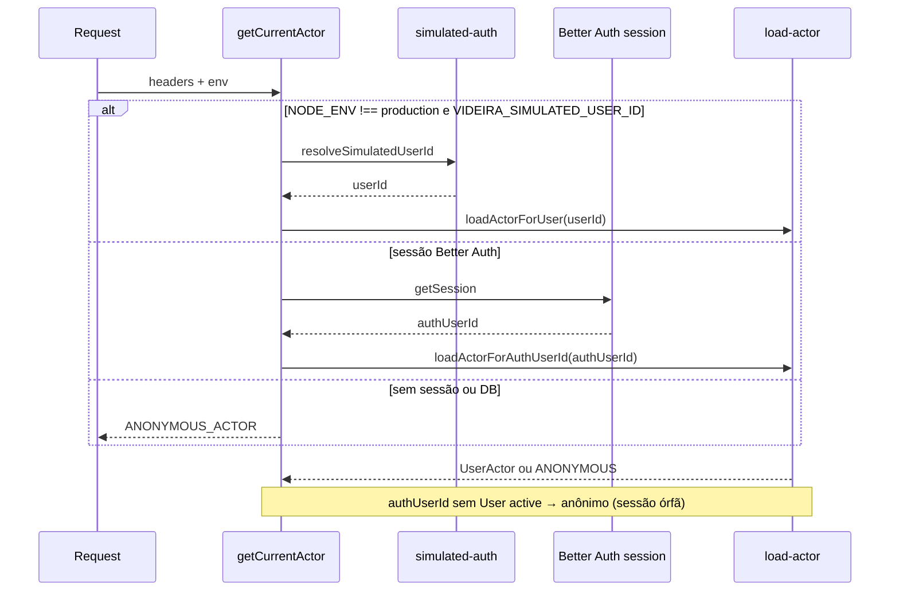

# Autenticação e autorização Design

**Spec**: `.specs/features/auth/spec.md`
**Status**: Draft

---

## Architecture Overview

O Better Auth cuida do OAuth com o Google, das sessões no banco e do logout. A identidade Google (`AuthUser`, tabelas do Better Auth) fica separada do membro da igreja (`User`, com papéis e grupos), ligados por `User.authUserId`. Toda regra de "quem pode entrar" roda dentro do callback do Google por `validateUserInfo`; toda regra de "quem pode fazer o quê" continua passando por `getCurrentActor()` (AD-007) e por uma política única.

```mermaid
graph TD
    Invite[/convite/código/] -->|valida hash, mostra dados| StartLogin[signInSocial com o código]
    Entrar[/entrar/] --> StartLogin
    StartLogin --> Google[Google OAuth]
    Google --> Callback[/api/auth/callback/google]
    Callback --> Gate[AccessGate: validateUserInfo]
    Gate -->|recusa| Entrar
    Gate -->|aceita| AfterHook[hook after: aceitar convite / bootstrap]
    AfterHook --> Session[(AuthSession)]
    Request[Página ou rota /api] --> CurrentActor[getCurrentActor]
    CurrentActor --> Session
    CurrentActor --> Member[(User + UserRole + WorshipTeamMember)]
    CurrentActor --> Policy[can / canPerform]
    Proxy[proxy.ts: redireciona sem cookie] -.-> Request
    Anon[Anônimo em /] --> Lyrics[PublicLyrics: DTO sem acordes]
```

Fluxo do convite:

1. `/convite/{código}` calcula o SHA-256 do código, busca o `Invite` e checa validade, uso e revogação. Inválido → mensagem da AUTH-18.
2. O botão chama `auth.api.signInSocial` no servidor (server action) com `provider: "google"`, `requestSignUp: true`, `additionalData: { inviteCode }`, `callbackURL: "/"` e `errorCallbackURL: "/entrar"`.
3. No callback, `user.validateUserInfo` (via `AccessGate`) checa `email_verified` em `source.oauth.profile`, recusa desativados e, em `sign-in`, exige `User` ativo ligado ao e-mail. Em `create-user`, exige convite válido com o mesmo e-mail ou bootstrap — o código do convite vem de `getOAuthState()` num hook `before` em `/callback/:id` (a doc do Better Auth expõe `getOAuthState` nos hooks do callback, não em `validateUserInfo`; dados de `additionalData` são não confiáveis e sempre revalidados no banco).
4. O hook `after` de `/callback/:id` chama `AccessGate.complete` → `acceptInvite` ou `bootstrapAdmin`; se o aceite falhar, apaga a sessão recém-criada.

---

## Módulo `lib/auth`

Bounded context de **identidade da requisição** e **permissões da igreja**. Convites (`lib/invites`), membros (`lib/members`) e política de setlist (`lib/setlists/setlist-policy.ts`) ficam fora; `lib/auth` só expõe o `Actor` e `can()` para eles consumirem.

### Superfície pública (imports permitidos fora de `lib/auth`)

| Export | Arquivo | Consumidores |
| --- | --- | --- |
| `Actor`, `ANONYMOUS_ACTOR`, `teamRoleOf`, `hasRole`, `isOrganizationManager` | `actor.ts` | setlists, worship-teams, layout, testes |
| `getCurrentActor` | `current-actor.ts` | páginas, rotas, serviços |
| `can`, `Permission` | `permissions.ts` | invites, members, import, persistence |
| `requireActor`, `requirePermission` | `api-guard.ts` | route handlers |
| `requirePageActor`, `safeNextPath` | `page-gate.ts` | `app/**/page.tsx` protegidas |
| `loadActorForUser`, `loadActorForAuthUserId` | `load-actor.ts` | testes e deps de rota (não usar em regra de negócio fora de `getCurrentActor`) |
| `seedSimulatedIdentities` | `simulated-identities.ts` | seed e fixtures |

**Interno** (só `lib/auth` e `app/api/auth`): `better-auth.ts`, `access-gate.ts`, `auth-config.ts`, `email.ts`, `simulated-auth.ts`.

### Layout alvo

```text
lib/auth/
  actor.ts                 # tipo Actor + helpers de papel/grupo
  permissions.ts           # Matriz AUTH-28
  current-actor.ts         # AD-007: sessão Better Auth → Actor
  load-actor.ts            # Prisma → Actor (roles + teams)
  access-gate.ts           # entrada (convite / bootstrap / sign-in)
  better-auth.ts           # getAuth(), hooks, validateUserInfo
  auth-config.ts           # env, AUTH_MISCONFIGURED (padrão import-module-config)
  email.ts                 # normalizeEmail
  api-guard.ts             # 401/403 JSON
  page-gate.ts             # redirect /entrar
  simulated-auth.ts
  simulated-identities.ts
  *.test.ts
```

### Resolução do `Actor` (`getCurrentActor`)



Prioridade documentada: fora de produção, `VIDEIRA_SIMULATED_USER_ID` definido **vence** a sessão real (dev/testes atuais).

### `Actor` (evolução de `actor.ts`)

```typescript
export type OrganizationRole =
  | "admin"
  | "manager"
  | "worship_leader"
  | "musician";

export type Actor =
  | { kind: "anonymous" }
  | {
      kind: "user";
      userId: UserId;
      organizationId: string;
      roles: ReadonlyArray<OrganizationRole>;
      teams: ReadonlyArray<{ teamId: WorshipTeamId; role: WorshipTeamRole }>;
    };
```

- `types/identity.ts` alinha `OrganizationRole` com o conjunto acima; remove o papel único `member`.
- `isOrganizationAdmin` → `hasRole(actor, "admin", organizationId)`; `isOrganizationManager` = `admin` ou `manager`.
- `load-actor.ts`: inclui `UserRole` onde `User.status = "active"`; ignora grupos arquivados (comportamento atual).

### `AccessGate` e Better Auth ( divisão de responsabilidade )

| Etapa | Onde | O quê |
| --- | --- | --- |
| Política de identidade OAuth | `user.validateUserInfo` → `access-gate.validateUserInfo` | `email_verified`; `sign-in` com membro ativo; recusa genérica `no_access` |
| Convite no primeiro login | `hooks.before` `/callback/:id` + `getOAuthState<{ inviteCode? }>()` | Para fluxo que cria usuário: valida hash/e-mail do convite antes de persistir `AuthUser` |
| Membro da igreja | `hooks.after` `/callback/:id` | `complete()` → `acceptInvite` / `bootstrapAdmin`; rollback de sessão se `invalid` |
| Config | `better-auth.ts` | `disableImplicitSignUp: true`; modelos `authUser` / `authSession` / …; sem cache de sessão em cookie |

`AccessGate` recebe repositórios por injeção nos testes (`InviteRepository`, `MemberRepository`); a implementação Prisma vive em `lib/invites` e `lib/members`, importada só em `better-auth.ts`.

### Requisitos mapeados só em `lib/auth`

| IDs | Componente |
| --- | --- |
| AUTH-01–08, AUTH-42–43, AUTH-61 | `better-auth.ts`, `access-gate.ts`, `auth-config.ts`, `page-gate.ts` |
| AUTH-07 | `current-actor.ts`, `load-actor.ts` |
| AUTH-28–34 | `permissions.ts`, `api-guard.ts`, `page-gate.ts` |
| AUTH-45–46 | `load-actor.ts` (Actor sempre do banco) + invalidação de sessão em `member-service` |

---

## Code Reuse Analysis

### Existing Components to Leverage

| Component | Location | How to Use |
| --- | --- | --- |
| `Actor`, `teamRoleOf` | `lib/auth/actor.ts` | Estender: `role` vira `roles`; novos helpers `hasRole`, `isOrganizationManager`. |
| `getCurrentActor` | `lib/auth/current-actor.ts` | Trocar a origem do `userId`: sessão do Better Auth; simulado só fora de produção. |
| `loadActorForUser` | `lib/auth/load-actor.ts` | Ler `UserRole`, filtrar `status = active`; ganhar variante por `authUserId`. |
| `resolveSimulatedUserId` | `lib/auth/simulated-auth.ts` | Mantido sem mudança. |
| `canPerform` | `lib/setlists/setlist-policy.ts` | Trocar `isOrganizationAdmin` por `isOrganizationManager`; remover leitura anônima. |
| `assertManageTeams` | `lib/worship-teams/worship-team-service.ts:27` | Passa a chamar `can(actor, "teams:manage", ...)`. |
| `wrapPersistenceRoute` | `lib/persistence/persistence-api.ts:96` | Ganha `meta.permission`; checa o `Actor` antes do handler e responde `401`/`403`. |
| Rate limiter em memória | `lib/import-access/unlock-rate-limit.ts` | Generalizar para `createFailureRateLimiter(limits)` e reusar no convite. |
| `resolveClientIp` | `lib/import-access/client-ip.ts` | Mover para `lib/http/client-ip.ts` e reusar. |
| Padrão de log único de configuração | `lib/import-access/import-module-config.ts` | Mesmo padrão para `AUTH_MISCONFIGURED`. |
| Selo "Importada" | `components/setlists/imported-badge.tsx` | Reusar na página pública de letras. |
| Seed de identidades | `lib/auth/simulated-identities.ts` | Atualizar para papéis em `UserRole`. |

### Integration Points

| System | Integration Method |
| --- | --- |
| Better Auth | `lib/auth/better-auth.ts` (servidor) + `app/api/auth/[...all]/route.ts` com `toNextJsHandler`. |
| Next 16 | `proxy.ts` na raiz: só checa a existência do cookie (`getSessionCookie`) e redireciona; a checagem real fica em cada página e rota. |
| Prisma / SQLite | `prismaAdapter(prisma, { provider: "sqlite" })`; tabelas do Better Auth com nomes `AuthUser`, `AuthSession`, `AuthAccount`, `AuthVerification` para não colidir com `User`. |
| Import | `canImport(request)` vira `canImport(actor)`; remove sessão por segredo. |
| Layout | `app/layout.tsx:39` passa a usar `can(actor, ...)` para mostrar links (Grupos, Usuários, Import). |

---

## Components

### BetterAuthConfig

- **Purpose**: Configurar o Better Auth uma vez, ou não configurar quando faltar variável em produção.
- **Location**: `lib/auth/better-auth.ts`
- **Interfaces**:
  - `getAuth(): Auth | undefined` - `undefined` quando a configuração está incompleta (AUTH-08).
- **Config**: `socialProviders.google` com `disableImplicitSignUp: true`; `session.expiresIn = 30 dias`, `session.updateAge = 1 dia`; `advanced.useSecureCookies: true`; `user.modelName = "authUser"` (e equivalentes); `emailAndPassword` desligado; `user.validateUserInfo = accessGate.validateUserInfo`; `hooks.before` em `/callback/:id` chama `accessGate.assertInviteForOAuthCreate` (lê `getOAuthState`); `hooks.after` em `/callback/:id` chama `accessGate.complete`.
- **Dependencies**: `better-auth`, Prisma, `BETTER_AUTH_SECRET`, `BETTER_AUTH_URL`, `GOOGLE_CLIENT_ID`, `GOOGLE_CLIENT_SECRET`.
- **Reuses**: padrão de config de `import-module-config.ts`.

### AccessGate

- **Purpose**: Decidir quem pode entrar e concluir convite ou bootstrap (AUTH-01 a AUTH-04, AUTH-16, AUTH-17, AUTH-42, AUTH-43).
- **Location**: `lib/auth/access-gate.ts`
- **Interfaces**:
  - `validateUserInfo({ user, source }): Promise<GateResult | void>` - callback do Better Auth. E-mail não verificado → `email_not_verified` (`source.oauth.profile.email_verified`); `sign-in` exige `User` ativo; `create-user` exige bootstrap elegível ou convite já validado no hook `before` (flag em contexto interno).
  - `assertInviteForOAuthCreate(ctx): Promise<void>` - hook `before` do callback: lê `inviteCode` de `getOAuthState`, consulta repositório, compara e-mail normalizado; aborta o fluxo se inválido.
  - `complete({ authUserId, email, inviteCode }): Promise<void>` - hook `after`: chama `acceptInvite` ou `bootstrapAdmin`; apaga sessão se aceite `invalid`; idempotente.
- **Dependencies**: `InviteRepository`, `MemberRepository`.
- **Reuses**: normalização de e-mail de `lib/auth/email.ts` (novo, `trim().toLowerCase()`).

### InviteService

- **Purpose**: Criar, listar, revogar e aceitar convites (AUTH-09 a AUTH-19, AUTH-62).
- **Location**: `lib/invites/invite-service.ts`, `lib/invites/prisma-invite-repository.ts`, `lib/invites/invite-token.ts`
- **Interfaces**:
  - `createInvite(actor, { email, roles, teamIds, expiresInHours }): Promise<{ invite, link }>`
  - `listPending(actor): Promise<InviteSummary[]>`
  - `revokeInvite(actor, inviteId): Promise<void>`
  - `findValidByCode(code, now): Promise<Invite | undefined>`
  - `acceptInvite(code, authUserId, email, now): Promise<"accepted" | "invalid">` - transação: `updateMany where tokenHash and usedAt null and revokedAt null and expiresAt > now` → se `count = 0`, `invalid` (AUTH-58); cria `User`, `UserRole`, `WorshipTeamMember` só para grupos não arquivados (AUTH-59); chama `reconcileSoleLeader`.
  - `generateInviteCode(): { code, hash }` - 32 bytes de `crypto.randomBytes`, base64url; hash SHA-256 hex.
- **Dependencies**: Prisma, `can`, `AuthAuditLog`.

### MemberService

- **Purpose**: Papéis, desativação, liderança de grupo (AUTH-21 a AUTH-27, AUTH-44 a AUTH-48, AUTH-60).
- **Location**: `lib/members/member-service.ts`, `lib/members/prisma-member-repository.ts`
- **Interfaces**:
  - `listMembers(actor)`
  - `setRoles(actor, userId, roles)` - checa `can(actor, "users:grantRole", { role })` para cada papel adicionado ou retirado; impede último admin (`409 LAST_ADMIN`).
  - `deactivate(actor, userId)` - `status = deactivated`, apaga `AuthSession` do `authUserId`, remove lideranças, chama `reconcileSoleLeader`.
  - `setTeamLeaders(actor, teamId, userIds)` - exige `worship_leader` (`400 NOT_A_WORSHIP_LEADER`).
  - `reconcileSoleLeader(tx, organizationId)` - se houver exatamente um `worship_leader` ativo, faz upsert dele como `leader` em todo grupo não arquivado; caso contrário não altera nada (AUTH-24, AUTH-25).
- **Dependencies**: Prisma, `can`, `AuthAuditLog`.
- **Reuses**: `WorshipTeamService.createTeam` passa a chamar `reconcileSoleLeader` depois de criar.

### Permissions

- **Purpose**: Aplicar a Matriz de permissões num só lugar (AUTH-28).
- **Location**: `lib/auth/permissions.ts`
- **Interfaces**:
  - `type Permission = "users:invite" | "users:manage" | "users:grantRole" | "teams:manage" | "music:write" | "import"`
  - `can(actor: Actor, permission: Permission, target: { organizationId: string; role?: OrganizationRole }): boolean`
  - `isOrganizationManager(actor, organizationId)` = `admin` ou `manager`.
- **Regras**: `users:invite`, `users:manage`, `teams:manage` → admin ou gestor; `users:grantRole` com `role: "admin"` → só admin; `music:write` e `import` → admin, gestor ou `worship_leader`.
- **Reuses**: `canPerform` dos setlists chama `isOrganizationManager` onde hoje chama `isOrganizationAdmin`.

### ApiGuard

- **Purpose**: `401`/`403` uniformes nas rotas (AUTH-31 a AUTH-33).
- **Location**: `lib/auth/api-guard.ts`
- **Interfaces**:
  - `requireActor(): Promise<{ actor: UserActor } | { response: Response }>` - `401 UNAUTHENTICATED`.
  - `requirePermission(permission, organizationId)` - `403 FORBIDDEN`.
- **Integração**: `wrapPersistenceRoute(meta, handler)` recebe `meta.permission` (`"music:read"` = qualquer usuário, `"music:write"`); rotas de setlists e grupos já recebem o `Actor` pelas deps e passam a responder `401` para anônimo.

### PageGate e proxy

- **Purpose**: Redirecionar anônimos (AUTH-29, AUTH-30).
- **Location**: `proxy.ts` (otimista, por cookie) e `lib/auth/page-gate.ts`
- **Interfaces**:
  - `requirePageActor(pathname): Promise<UserActor>` - chama `redirect("/entrar?next=...")` do Next se anônimo; usado nas páginas server.
  - `safeNextPath(raw): string` - aceita só caminho que começa com `/` e não com `//`.
- **Rotas públicas**: `/`, `/entrar`, `/convite/[code]`, `/letras/[songId]`, `/api/auth/*`.

### PublicLyrics

- **Purpose**: Catálogo e letra para anônimos sem acordes (AUTH-35 a AUTH-41).
- **Location**: `lib/public-lyrics/public-lyrics.ts`, `app/letras/[songId]/page.tsx`, `components/public-lyrics/*`
- **Interfaces**:
  - `listPublicSongs(prisma): Promise<PublicSongSummary[]>` - `{ id, title, artist }` de `Song.publicLyrics = true` com ao menos uma cifra `format = "lyrics"`.
  - `getPublicLyrics(prisma, songId): Promise<PublicLyrics | undefined>` - cifra `lyrics` mais recente; `undefined` → `notFound()` (AUTH-38).
  - `toPublicLyrics(song, chart): PublicLyrics` - função pura: `{ title, artist, imported: { originUrl } | null, sections: [{ label, lines: string[] }] }`. Nunca copia `chords`, `key`, `capo`, `tempo`, `timeSignature`, `notes` nem ids (AUTH-37).
- **Integração**: `app/page.tsx` renderiza o catálogo quando o `Actor` é anônimo; os componentes recebem só o DTO, então nada de acorde vai ao HTML nem ao payload do RSC.

### PublicVisibilityField

- **Purpose**: Opção "Visível ao público" com ícone de informação (AUTH-40, AUTH-41).
- **Location**: `components/songs/public-visibility-field.tsx`
- **Integração**: formulário de cadastro/edição de música e `components/import/import-workflow.tsx`; o valor viaja em `PUT /api/songs/{songId}` e `POST /api/song-charts` como `publicLyrics`.

### Telas de administração

- **Location**: `app/usuarios/page.tsx` (lista de membros e convites pendentes), `components/users/invite-form.tsx` (e-mail, papéis, grupos, validade em horas/dias, botões "Copiar link" e "Compartilhar no WhatsApp"), `components/users/member-roles-editor.tsx`.
- **APIs**: `POST /api/invites`, `GET /api/invites`, `DELETE /api/invites/{inviteId}`, `GET /api/members`, `PUT /api/members/{userId}/roles`, `POST /api/members/{userId}/deactivate`, `PUT /api/teams/{teamId}/leaders`.

---

## Data Models

```prisma
model User {
  id              String              @id
  organizationId  String
  authUserId      String?             @unique
  name            String
  email           String
  status          String              @default("active") // active | deactivated
  deactivatedAt   DateTime?
  roles           UserRole[]
  teamMemberships WorshipTeamMember[]
  // remove: role
  @@unique([organizationId, email])
}

model UserRole {
  userId String
  user   User   @relation(fields: [userId], references: [id], onDelete: Cascade)
  role   String // admin | manager | worship_leader | musician
  @@id([userId, role])
  @@index([role])
}

model Invite {
  id              String    @id @default(cuid())
  organizationId  String
  email           String    // normalizado
  tokenHash       String    @unique
  roles           Json      // string[]
  teamIds         Json      // string[]
  expiresAt       DateTime
  createdByUserId String
  createdAt       DateTime  @default(now())
  usedAt          DateTime?
  usedByUserId    String?
  revokedAt       DateTime?
  @@index([organizationId, email])
}

model AuthAuditLog {
  id           String   @id @default(cuid())
  occurredAt   DateTime @default(now())
  actorUserId  String?
  action       String   // invite.create | invite.revoke | invite.accept | roles.change | team.leaders | user.deactivate | bootstrap.admin
  targetUserId String?
  targetEmail  String?
  details      Json?
  @@index([occurredAt])
}

model Song {
  // ...
  publicLyrics Boolean @default(false)
}

model ImportLog {
  // ...
  userId String?
}

// AuthUser, AuthSession, AuthAccount, AuthVerification: schema gerado pelo CLI do Better Auth com modelName mapeado.
```

**Relationships**: `User.authUserId` → `AuthUser.id` (1:1 nesta entrega). `WorshipTeamMember.role = "leader"` continua sendo a atribuição de liderança; o papel `worship_leader` fica em `UserRole`.

**Migração dos dados existentes**: `role = "admin"` → `UserRole(admin)`; `role = "member"` com alguma liderança → `UserRole(worship_leader)`; demais → `UserRole(musician)`; depois a coluna `role` sai. O seed simulado passa a gravar `user-admin: admin`, `user-leader: worship_leader`, `user-musician: musician`.

**Tipos**: `OrganizationRole = "admin" | "manager" | "worship_leader" | "musician"`; `Actor.user.roles: ReadonlyArray<OrganizationRole>`.

---

## Error Handling Strategy

| Error Scenario | Handling | User Impact |
| --- | --- | --- |
| Conta sem acesso | `validateUserInfo` devolve `{ error: "no_access" }`; Better Auth redireciona para `errorCallbackURL` | `/entrar` mostra a mensagem da AUTH-02. |
| E-mail não verificado | `{ error: "email_not_verified" }` | Mesma mensagem da AUTH-02. |
| E-mail diferente do convite | `{ error: "invite_email_mismatch" }`; `/entrar` relê o convite para mostrar o e-mail | Mensagem da AUTH-17. |
| Convite inválido, corrida no aceite | `acceptInvite` → `invalid`; sessão criada pelo Better Auth é apagada no mesmo hook | Mensagem da AUTH-18. |
| Usuário cancela no Google | `error=access_denied` no `errorCallbackURL` | Mensagem da AUTH-61. |
| Configuração incompleta em produção | `getAuth()` → `undefined`; rota `/api/auth/*` responde `503 AUTH_UNAVAILABLE` | "Login indisponível". |
| Rota sem sessão / sem permissão | `ApiGuard` | `401 UNAUTHENTICATED` / `403 FORBIDDEN`. |
| Excesso de códigos inválidos | Rate limiter por IP | `429` com `Retry-After`. |

---

## Risks & Concerns

| Concern | Location (file:line) | Impact | Mitigation |
| --- | --- | --- | --- |
| Rotas de músicas e cifras gravam sem checar ninguém | `app/api/songs/[songId]/route.ts:76`, `app/api/charts/[chartId]/route.ts:66`, `app/api/song-charts/route.ts:59` | Qualquer visitante altera o repertório. | `wrapPersistenceRoute` com `meta.permission` (AUTH-33), coberto por testes de rota. |
| `upsert` de música e cifra busca só pelo `id`, sem a igreja | `lib/persistence/prisma-music-repository.ts:49` (`saveSong`) e `saveChart` | Com mais de uma igreja, um usuário com `music:write` sobrescreve música ou cifra de outra igreja enviando o `id` dela. | Gravar só quando o registro não existe ou pertence à igreja do `Actor`; `id` de outra igreja → `404 SONG_NOT_FOUND` / `CHART_NOT_FOUND`. Teste com duas igrejas. |
| Migração local aberta | `app/api/migrations/local-data/route.ts:56` | Gravação em massa sem login. | Exigir `music:write`. |
| Leitura anônima de setlists | `lib/setlists/setlist-policy.ts:86` | Contraria AD-010. | Remover o ramo anônimo; ajustar os testes da `setlists` que esperam leitura anônima. |
| Nome de model `User` colide com o default do Better Auth | `prisma/schema.prisma` | Better Auth gravaria na tabela errada. | `modelName` para `authUser` etc.; validar no primeiro task (spike). |
| `additionalData` do OAuth é não confiável | Better Auth OAuth doc | Convite forjado no cliente. | Validar hash e e-mail no hook `before` + repositório; nunca confiar só no state. |
| `emailVerified` no `user` mapeado | Better Auth | Campo mapeado pode divergir do perfil bruto. | Fonte primária: `source.oauth.profile.email_verified === true` na AUTH-03. |
| Sessão Better Auth criada antes do hook `after` falhar | callback | Sessão órfã sem membro. | `getCurrentActor` trata `authUserId` sem `User` ativo como anônimo; o hook apaga a sessão em `invalid`. |
| Rate limit e reconciliação em processo único | `lib/import-access/unlock-rate-limit.ts` | Com várias instâncias, limites por processo. | Aceito: um processo nesta fase (AD-004). |
| Testes do import dependem da sessão por segredo | `app/api/imports/session/route.test.ts` | Quebram ao remover AD-005. | Remover junto com a rota (AUTH-51); G1-G3 da `import-access` sobre a sessão ficam obsoletas. |

---

## Tech Decisions

| Decision | Choice | Rationale |
| --- | --- | --- |
| Biblioteca | Better Auth `1.7.x` | Mantida; Auth.js v5 segue em beta e em modo manutenção pelo próprio time do Better Auth. |
| Identidade vs. membro | Tabelas do Better Auth separadas de `User` | Não mistura schema da lib com o domínio; abre caminho para uma conta em várias igrejas. |
| Papéis | Tabela `UserRole` | SQLite sem arrays; permite contar `worship_leader` ativos com índice. |
| Renovação da sessão | `updateAge = 1 dia` | Atende "30 dias sem uso" com no máximo uma escrita por dia por sessão. |
| Cache de sessão em cookie | Desligado | Desativação e troca de papel valem na próxima requisição (AUTH-45, AUTH-46). |
| Proxy | Só checagem de cookie | Recomendação da doc do Better Auth para Next 16; a autorização real fica nas rotas. |
| Página pública | Server components com DTO, sem API pública | Menos superfície; o teste mira `toPublicLyrics` e o HTML. |
| Prioridade do usuário simulado | Fora de produção, `VIDEIRA_SIMULATED_USER_ID` definido vence a sessão | Mantém os testes e o desenvolvimento atuais; documentado no `.env.example`. |
