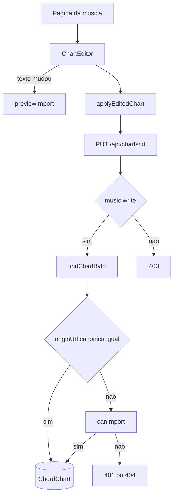

# Edição de cifra salva — Design

**Spec**: `.specs/features/chart-edit/spec.md`
**Status**: Approved

---

## Architecture Overview

A correção acontece na página da música e grava na cifra que já existe. O parser do import só roda quando o texto muda. Tom, capo e tipo de seção são controles do rascunho. O `PUT /api/charts/{chartId}` continua a escrita. `music:write` basta quando a `originUrl` canônica não muda. Criar com origem, ou trocar a `originUrl`, continua em `canImport`.

Isso cabe na AD-004 (repositório), na AD-006 (selo e link da fonte permanecem), na AD-007 (`getCurrentActor` e `can`) e na AD-012 (sem capacidade nova). A AD-005 continua dona da busca e do primeiro save importado. A AD-013 restringe quando o gate de import entra numa escrita de cifra.

Não há tabela nova nem campo novo. `source`, `sections`, `key`, `capo` e `origin` já existem em `ChordChart`.

Enquanto o texto do rascunho é igual ao `source` gravado, o save reusa as seções gravadas e só aplica tipo, tom e capo. Reprocessar nesse momento reclassificaria acordes que só os `chordTokens` da página reconheceram, e a pessoa não editou o texto.

---

## Code Reuse Analysis

### Existing Components to Leverage

| Component | Location | How to Use |
| --- | --- | --- |
| `previewImport` | `lib/import/preview-import.ts` | Reprocessar o texto editado. Passar a `origin` já gravada. |
| `ChordChartPreview` | `components/chord-chart/chord-chart-preview.tsx` | Preview do rascunho, ao lado ou abaixo do texto. |
| `PUT /api/charts/{chartId}` | `app/api/charts/[chartId]/route.ts` | Save. Já exige `music:write`. |
| `parseChartJson` | `lib/persistence/validate-persistence-input.ts` | Validar o corpo. O tom da lista fechada é uma checagem a mais neste `PUT`. |
| `canImport` | `lib/import-access/import-access-policy.ts` | Só quando a origem muda ou a cifra nasce com origem. |
| `canonicalizeOriginUrl` | `lib/persistence/origin-url.ts` | Comparar a origem do corpo com a gravada. |
| `isTransposableKey` | `lib/chords/transpose-chord.ts` | Não usar como lista. A lista da revisão do import é a fonte do CED-15. |
| Página da música | `app/songs/[songId]/song-detail.tsx` | Mostra o botão e monta o editor. Não absorve o formulário. |

### Integration Points

| System | Integration Method |
| --- | --- |
| Catálogo | `listChartsBySong` já devolve `source` e `origin`. O editor lê o que a página carregou. |
| Setlist | O item guarda `chartId`. Nenhum update de setlist. A leitura passa a ver as seções novas. |
| ImportLog | `POST /api/song-charts` continua registrando o save importado. O `PUT` da mesma origem não registra. |
| Letra pública | O flag `publicLyrics` não muda. O texto público sai das seções novas, ainda sem acordes. |

---

## Components

### `TONALITY_OPTIONS` e rótulos de seção

- **Purpose**: Uma lista de tom e os rótulos de tipo, compartilhados pela revisão do import, pelo editor e pelo `PUT`.
- **Location**: `lib/charts/chart-edit-options.ts`
- **Interfaces**:
  - `TONALITY_OPTIONS: readonly string[]` — os 30 tons da revisão do import, de `C` a `Bm`.
  - `SECTION_TYPE_OPTIONS: { value: SectionType; label: string }[]` — os oito tipos já usados no import.
  - `isEditableChartKey(key: string): boolean` — verdadeiro só se `key` está em `TONALITY_OPTIONS`.
- **Dependencies**: `SectionType` em `types/music.ts`.
- **Reuses**: O array hoje privado em `components/import/import-workflow.tsx`. O import passa a importar daqui.

### `applyEditedChart`

- **Purpose**: Montar a cifra que o `PUT` grava, sem gerar id novo e sem deixar o parser trocar o que a spec manda preservar.
- **Location**: `lib/charts/apply-edited-chart.ts`
- **Interfaces**:
  - `applyEditedChart(input: ApplyEditedChartInput): ChordChart`
  - `ApplyEditedChartInput`: `existing`, `key`, `capo?: number`, `sectionTypes: Record<string, SectionType>`, `parsed?: ImportDraft`
- **Dependencies**: `previewImport` só no chamador. Esta função não busca rede e não grava.
- **Reuses**: O formato `ChordChart`.

Regras da função:

- Copia `id`, `songId`, `title`, `format`, `timeSignature`, `tempo` e `origin` de `existing`.
- Grava `key` do controle. Capo ausente omite o campo, e o Prisma grava `null`.
- Sem `parsed`: seções de `existing`, com o tipo substituído quando `sectionTypes` tiver o id. `source` permanece.
- Com `parsed`: seções e `source` do draft. `sectionTypes` ainda por cima, para o ajuste feito depois do parse.

### `ChartEditor`

- **Purpose**: Editar uma cifra lyrics com `source`, mostrar preview e avisos, e salvar.
- **Location**: `components/songs/chart-editor.tsx`
- **Interfaces**:
  - `ChartEditor({ chart, repository, onSaved, onCancel })`
  - `onSaved(): void` — a página recarrega as cifras e fecha o editor.
  - `onCancel(): void` — fecha sem gravar.
- **Dependencies**: `previewImport`, `applyEditedChart`, `HttpMusicRepository.saveChart`, `ChordChartPreview`.
- **Reuses**: Classes do design system já usadas no import (`ds-input`, `ds-card`).

Comportamento:

- Estado inicial: texto = `chart.source`, tom = `chart.key`, capo = `chart.capo`, tipos = os da cifra. Sem parse.
- Só uma cifra entra em edição por vez. Com o editor aberto, o botão das outras fica desabilitado.
- Texto vazio: não salva, mensagem `Informe o texto da cifra.`
- Texto acima de 500 KiB UTF-8: não salva, mensagem `O texto deve ter no máximo 500 KiB.` A medição é `TextEncoder`, como no import.
- Texto diferente do `source`: `previewImport({ text, origin: chart.origin })`. Os tipos voltam aos do parser. Tom e capo dos controles ficam como a pessoa deixou.
- Avisos do draft aparecem antes do save.
- Tom fora de `TONALITY_OPTIONS`: o save fica desabilitado. Se o tom gravado estiver fora da lista, o select mostra esse valor e não envia até a pessoa escolher um da lista.
- Save chama `repository.saveChart(applyEditedChart(...))`. Falha de rede ou `4xx`/`5xx` mantém o rascunho na página. Mensagem: `Nada foi salvo. Revise os dados e tente novamente.`
- Sucesso: `onSaved`. A página não navega.

### Página da música

- **Purpose**: Decidir quem vê "Editar cifra" e qual cifra está aberta.
- **Location**: `app/songs/[songId]/song-detail.tsx`
- **Interfaces**: o componente já recebe `canEditMusic`. Ganha `editingChartId: string | null`.
- **Dependencies**: `ChartEditor`.
- **Reuses**: `canEditMusic`, que a page já calcula com `music:write`.

O botão aparece só quando `canEditMusic`, `persistedCharts`, `chart.format === "lyrics"` e `chart.source` não é vazio. Cifra de exemplo, grade e cifra sem `source` não mostram o botão.

### `findChartById`

- **Purpose**: O `PUT` precisa da cifra da igreja antes de decidir o gate.
- **Location**: `ChartRepository` em `lib/persistence/music-repository.ts`, com implementação em `PrismaMusicRepository`, `InMemoryMusicRepository` e `IndexedDbMusicRepository`.
- **Interfaces**:
  - `findChartById(id: ChordChartId): Promise<ChordChart | undefined>`
- **Dependencies**: No Prisma, `organizationId` e `id` na mesma consulta.
- **Reuses**: `toDomainChart`.

`HttpMusicRepository` implementa o método devolvendo `undefined`. O editor não chama. A página já tem a cifra vinda de `listChartsBySong`.

### Gate do `PUT`

- **Purpose**: Separar correção de importação nova.
- **Location**: `app/api/charts/[chartId]/route.ts` e uma função pura ao lado de `lib/import-access/chart-origin-gate.ts`.
- **Interfaces**:
  - `chartOriginGateKind(existing: ChordChart | undefined, body: unknown): "allow" | "import"`
- **Dependencies**: `canonicalizeOriginUrl`, `gateChartWriteWithOrigin`, `isEditableChartKey`.
- **Reuses**: `canImport` sem mudar a regra da flag nem da capacidade `import`.

`chartOriginGateKind` devolve `import` quando não existe cifra e o corpo tem `origin`, ou quando a `originUrl` canônica do corpo é diferente da gravada. Inclusive quando o corpo apaga a origem. Nos outros casos, devolve `allow`.

Ordem no `PUT`, depois do `wrapPersistenceRoute` com `music:write`:

1. Sem ator: `401 UNAUTHENTICATED`. Sem `music:write`: `403 FORBIDDEN`. Isso já é o wrapper.
2. JSON inválido: `400 INVALID_REQUEST`. Corpo grande: `413`. Já existe.
3. `parseChartJson`. Falha: `422 VALIDATION_FAILED`.
4. `id` do corpo diferente do path: `422`. Já existe.
5. `findChartById`. Se existir e `songId` do corpo for outro: `422`.
6. Tom fora de `TONALITY_OPTIONS`: `422 VALIDATION_FAILED`.
7. `chartOriginGateKind`. `import` chama `gateChartWriteWithOrigin`. Flag desligada: `404 NOT_FOUND`. Sem capacidade `import`: `401 IMPORT_LOCKED`.
8. `allow`: `saveChart` e `204`. Sem `ImportLog`.
9. Caminho `import` que passa no gate: `saveChart`, `204`, e o `ImportLog` de save que já existe.

`POST /api/song-charts` não muda. Continua exigindo o gate sempre que o corpo tem origem.

---

## Data Models

Nenhum modelo novo. A escrita atualiza a linha `ChordChart` existente.

Campos que mudam neste save: `source`, `sections`, `key`, `capo`, `updatedAt`.

Campos que a função preserva: `id`, `organizationId`, `songId`, `title`, `format`, `timeSignature`, `tempo`, `origin`, `originUrl`, `schemaVersion`.

`song.defaultKey` não entra no `PUT`.

---

## Error Handling Strategy

| Error Scenario | Handling | User Impact |
| --- | --- | --- |
| Texto vazio | O editor não chama o `PUT` | `Informe o texto da cifra.` |
| Texto acima de 500 KiB UTF-8 | O editor não chama o `PUT` | `O texto deve ter no máximo 500 KiB.` |
| Tom fora da lista | Save desabilitado. Se o pedido chegar, `422 VALIDATION_FAILED` | A pessoa escolhe um tom da lista |
| Sem sessão | `401 UNAUTHENTICATED` | O rascunho permanece |
| Sem `music:write` | `403 FORBIDDEN`. O botão nem aparece | Sem editor |
| Mesma origem, flag de import desligada | `204` | A correção grava |
| Origem nova e flag desligada | `404 NOT_FOUND` | Nada grava. O rascunho permanece |
| Origem nova sem capacidade `import` | `401 IMPORT_LOCKED` | Nada grava. O rascunho permanece |
| Corpo inválido | `422 VALIDATION_FAILED` | `Nada foi salvo. Revise os dados e tente novamente.` |
| Banco falha | `500` ou `503` já mapeados | Mesma frase. O rascunho permanece |
| `songId` diferente do gravado | `422` | Nada grava |

O log de persistência continua sem o texto da cifra. O caminho `allow` não chama `recordSuccessfulChartSave` nem `recordFailedChartSave`.

---

## Risks & Concerns

| Concern | Location (file:line) | Impact | Mitigation |
| --- | --- | --- | --- |
| Todo corpo com `origin` cai no gate de import | `lib/import-access/chart-origin-gate.ts:26` | Quem só tem `music:write` não corrige cifra importada, e a flag desligada também bloqueia | `chartOriginGateKind` deixa passar a mesma `originUrl` |
| `saveChart` faz upsert e pode criar | `lib/persistence/prisma-music-repository.ts:87` | Um `PUT` com id novo e `origin` seria uma importação | Sem linha existente e com `origin`, o kind é `import` |
| `previewImport` fixa `timeSignature` em `4/4` e gera `origin` paste | `lib/import/preview-import.ts:101` | Um save após parse perderia compasso, andamento, título e a origem real | `applyEditedChart` copia esses campos de `existing` |
| `parseChartJson` aceita qualquer tom não vazio | `lib/persistence/validate-persistence-input.ts:192` | O `PUT` gravaria um tom fora da lista da spec | Checagem de `TONALITY_OPTIONS` neste `PUT`, além do parser |
| `chordTokens` não são persistidos | `lib/import/sources/cifraclub-parse.ts:130` | Reprocessar sem editar o texto pode mover acorde | Sem `parsed` enquanto o texto não muda. Com texto novo, os avisos aparecem antes do save |
| Ids de seção são o índice | `lib/import/assemble-sections.ts:111` | Um override de tipo sobreviveria a um parse novo no id errado | Cada mudança de texto zera `sectionTypes` e usa os tipos do parser |
| A página da música já concentra leitura, transpose e visibilidade | `app/songs/[songId]/song-detail.tsx:309` | O formulário deixaria o arquivo maior e mais frágil | `ChartEditor` fica em outro arquivo. A página só alterna `editingChartId` |
| Não há teste de rota para o gate de origem no `PUT` | `app/api/charts/[chartId]/route.ts:35` | A regressão do CED-18 passaria silenciosa | Teste do `PUT` com `music:write` sem `import`, e outro trocando `originUrl` |
| `HttpMusicRepository.findChartById` não tem rota | `lib/persistence/http-music-repository.ts:75` | Um cliente que chamar o método recebe `undefined` | O editor usa a cifra já listada. Só o Prisma no `PUT` consulta por id |

---

## Tech Decisions

| Decision | Choice | Rationale |
| --- | --- | --- |
| Onde o parse roda | No cliente, com `previewImport` | O mesmo parser do import. O servidor grava a cifra já estruturada, como o save atual. |
| Quando reprocessar | Só se o texto mudou | Abrir e salvar capo ou tipo não reinterpreta acordes que dependiam dos tokens da página. |
| Tom e capo ao mudar o texto | Os controles não são sobrescritos | CED-05 manda recolocar os tipos. Não manda trocar o tom nem o capo que a pessoa já escolheu. |
| Um editor por vez | O segundo botão fica desabilitado | Evita descartar um rascunho ao abrir outra cifra. |
| Lista de tom | `TONALITY_OPTIONS` extraída do import | CED-15 cita essa lista. `isTransposableKey` não é a fonte, para as duas não divergirem. |
| Gate | Função pura `allow` ou `import`, comparando URL canônica | A AD-013 fica testável sem sessão. `canImport` não muda. |
| AD-013 | Correção da mesma origem é `music:write`. Origem nova segue o gate de import | Separa as duas capacidades que a AD-012 já nomeia. Não substitui a AD-005. |

> **Project-level decisions:** AD-013 está em `.specs/STATE.md`.
