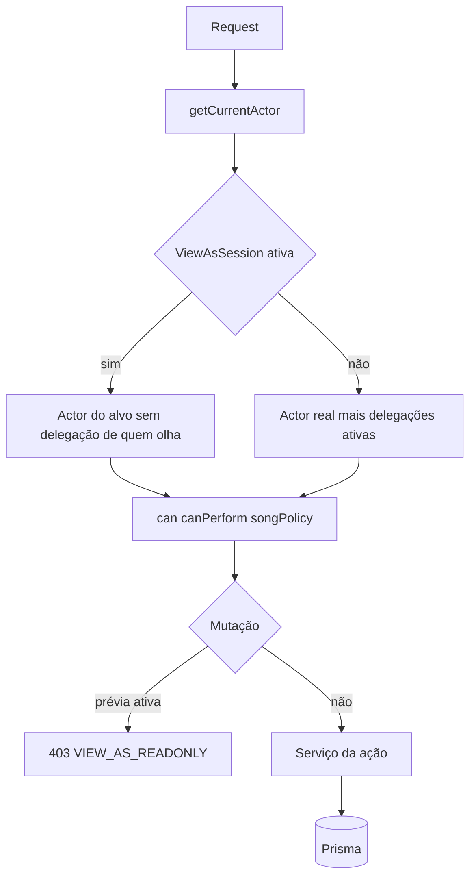

# Escopo adiado Design

**Spec**: `.specs/features/deferred-scope/spec.md`
**Status**: Draft

---

## Architecture Overview

Um módulo por ação. A identidade continua em `getCurrentActor()` (AD-007). A decisão de acesso continua em `can()`, `canPerform()` e uma política nova de música. Nenhuma ação nova cria sessão Better Auth.

Três formas foram consideradas. As três entregam a mesma spec.

1. **Módulos por ação, no `Actor` que já existe.** Delegação e “ver como” entram na montagem do `Actor`. Lixeira, histórico, sugestão, link e cobrança são serviços próprios com tabela própria. É o caminho deste design.
2. **Uma tabela genérica de concessão** para lixeira, link, delegação e prévia. Os ciclos de vida não batem: lixeira é flag na música, link é token, delegação expira, prévia troca o ator. Uma tabela só esconde isso.
3. **Personificação do Better Auth.** Cria `AuthSession` do alvo e a escrita sai em nome dele. A spec proíbe as duas coisas (SEE-12, SEE-09).



A prévia é a única troca de ator, e acontece dentro de `getCurrentActor`. “Sair” é a única mutação permitida enquanto ela dura.

---

## Code Reuse Analysis

### Existing Components to Leverage

| Component | Location | How to Use |
| --- | --- | --- |
| `getCurrentActor` | `lib/auth/current-actor.ts` | Único lugar que aplica prévia e delegação. |
| `can` / `hasCapability` | `lib/auth/permissions.ts`, `lib/auth/actor.ts` | Ganham as capacidades novas. `users:invite` satisfaz `users:invite:led` aqui, não no preset do gestor. |
| `canPerform` | `lib/setlists/setlist-policy.ts` | Autor edita conteúdo. `setlists:led` delegado só vale nos `teamIds` da delegação. Anônimo continua sem ler setlist por esta função. |
| `generateInviteCode` / `hashInviteCode` | `lib/invites/invite-token.ts` | O link público usa o mesmo token de 32 bytes e o mesmo SHA-256. |
| `createFailureRateLimiter` | `lib/http/failure-rate-limit.ts` | Outra instância, só para `/s/`. Não divide o balde com o convite. |
| `toPublicLyrics` | `lib/public-lyrics/public-lyrics.ts` | Cada música do link público passa por aqui. Sem acordes. |
| `createInvite` | `lib/invites/invite-service.ts` | O ramo do líder entra antes da regra atual. Gestor com `users:invite` segue o fluxo de hoje. |
| `saveChart` | `lib/persistence/prisma-music-repository.ts` | Continua um upsert sem histórico. Quem grava revisão é o serviço de cifra, não o repositório. |
| `gateChartWriteWithOrigin` | `lib/import-access/chart-origin-gate.ts` | Autor sem `import` continua caindo neste gate (OWN-06, OWN-07). |
| `wrapPersistenceRoute` | `lib/persistence/persistence-api.ts` | `PUT` de cifra e de música deixa de exigir `music:write` na porta. A política decide. Mutação com prévia ativa morre aqui. |
| `authAuditLog.create` | serviços de convite, papel e membro | Mesma forma: `action`, `actorUserId`, `targetUserId`, `details`. Sem texto de cifra. |
| Presets | `lib/auth/capabilities.ts` | Quatro capacidades novas. `org:settings` e `users:impersonate` só no admin, junto da trava da AD-014. |
| Página de grupos | `app/groups/page.tsx` | Gestor com `teams:manage` continua no `TeamManager`. Líder sem essa capacidade passa a ver só os grupos que lidera. |

### Integration Points

| System | Integration Method |
| --- | --- |
| Prisma / SQLite | Colunas novas em `Organization`, `Song`, `ChordChart`, `Setlist`. Tabelas novas para revisão, sugestão, link, delegação, prévia e evento Stripe. |
| Proxy | `proxy.ts` libera `/s/` e `/api/billing/webhook`. `/s/` aplica o limitador de código inválido. O webhook não usa sessão. |
| Stripe | SDK `stripe`, Checkout `mode: subscription`, Customer Portal, webhook com corpo cru. Período lido em `items.data[0].current_period_end` (API Basil, março de 2025: o campo saiu da subscription). |
| Setlist item | O `include` do item já traz a música. Passa a trazer `deletedAt` para marcar `unavailable`. |
| AD-014 | Esta feature não devolve ao gestor a área de usuário. `org:settings` e `users:impersonate` ficam no mesmo grupo “só admin”. |

---

## Components

### Catálogo de capacidades

- **Purpose**: Publica as quatro capacidades e a regra de quem pode recebê-las.
- **Location**: `lib/auth/capabilities.ts`, `lib/roles/role-service.ts`
- **Interfaces**:
  - `CAPABILITIES` passa a incluir `users:invite:led`, `music:delete`, `org:settings`, `users:impersonate`
  - `ADMIN_ONLY_CAPABILITIES = ["org:settings", "users:impersonate"]`
  - `assertNoAdminOnlyCapability(capabilities: readonly string[]): void` — lança `409 ROLE_CAPABILITY_FORBIDDEN`
- **Dependencies**: presets atuais
- **Reuses**: `capabilitiesMatchAdminPreset`, no mesmo ponto de `createRole` e `updateRole`
- **Presets**: `worship_leader` ganha `users:invite:led` e não ganha `users:invite`. `manager` e `admin` ganham `music:delete`. Só `admin` ganha `org:settings` e `users:impersonate`. `can("users:invite:led")` é verdadeiro se o ator tem `users:invite:led` ou `users:invite`.

### Actor efetivo

- **Purpose**: Aplica delegação no ator real, ou troca para o alvo da prévia.
- **Location**: `lib/auth/actor.ts`, `lib/auth/load-actor.ts`, `lib/auth/current-actor.ts`
- **Interfaces**:
  - `Actor` de usuário ganha `delegations: readonly DelegationGrant[]` e `viewAs?: { realUserId: UserId; expiresAt: string }`
  - `loadActiveDelegations(prisma, userId, now): Promise<DelegationGrant[]>`
  - `loadActiveViewAs(prisma, viewerUserId, now): Promise<ViewAsSession | undefined>`
- **Dependencies**: tabelas `CapabilityDelegation` e `ViewAsSession`
- **Reuses**: `loadActorForUser`
- **Ordem**: resolve o usuário real (sessão, ou simulado fora de produção). Se há prévia válida, carrega o alvo, copia `viewAs` e não soma a delegação de quem olha (SEE-13). A delegação do alvo entra, porque é assim que o alvo vê o app. Se a prévia venceu, apaga a linha, audita `view_as.end` e segue com o ator real. Sem prévia, soma as delegações ativas de quem entrou.

`DelegationGrant` carrega `capabilities`, `teamIds` e `expiresAt`. O banner usa o menor `expiresAt` ativo, em `America/Sao_Paulo`, formato `DD/MM/AAAA`.

### Trava de prévia

- **Purpose**: Impede escrita durante a prévia, com uma exceção.
- **Location**: `lib/auth/view-as-guard.ts`
- **Interfaces**:
  - `viewAsMutationResponse(actor: Actor): Response | undefined` — `403` `VIEW_AS_READONLY`, ou `undefined` se não há prévia
- **Dependencies**: `Actor.viewAs`
- **Reuses**: `forbiddenResponse` só como modelo de JSON `{ error: { code } }`
- **Onde chama**: `wrapPersistenceRoute` em método que não é `GET`, o serviço de setlist em toda escrita, `createInvite`, e os serviços novos de escrita. A rota de sair da prévia não chama a trava.

### Política de música

- **Purpose**: Decide editar, excluir e restaurar sem espalhar `createdByUserId` nas rotas.
- **Location**: `lib/songs/song-policy.ts`
- **Interfaces**:
  - `canEditChartContent(actor, chart): boolean` — mesma igreja, música sem `deletedAt`, e (`music:write` ou autor)
  - `canEditSongContent(actor, song): boolean` — mesma regra para título, artista, gênero, notas e tom
  - `canChangePublicLyrics(actor, song): boolean` — só `music:write`
  - `canDeleteSong(actor, organizationId): boolean` — `music:delete`
- **Dependencies**: `hasCapability`
- **Reuses**: nada de papel pelo nome

O `PUT /api/charts/{chartId}` e o `PUT /api/songs/{songId}` passam a usar `music:read` na porta (“é membro”). O handler chama a política. Autor sem `music:write` que mexe em `publicLyrics` recebe `403 PUBLIC_LYRICS_FORBIDDEN` e o valor gravado fica. Origem nova segue `chartOriginGateKind`.

### Convite do líder

- **Purpose**: Abre `createInvite` para o líder sem alargar o convite do gestor.
- **Location**: `lib/invites/invite-service.ts`, `app/groups/[teamId]/page.tsx`, `components/groups/team-invite-form.tsx`
- **Interfaces**:
  - `createInvite` — se o ator não tem `users:invite` e tem `users:invite:led`, exige `roles === ["musician"]` e cada `teamId` ativo e liderado por ele. Senão `403 FORBIDDEN`. Com `users:invite`, o corpo segue as regras atuais.
- **Dependencies**: `teamRoleOf`, `can`
- **Reuses**: validação de e-mail, `USER_EXISTS`, auditoria `invite.create`, `POST /api/invites`
- **Página**: `/groups` com `teams:manage` permanece o `TeamManager`. Sem `teams:manage`, lista os grupos em que o ator é líder, cada um com link para `/groups/{teamId}`. Essa página mostra o formulário só se `teamRoleOf === "leader"`. O formulário manda e-mail, `roles: ["musician"]`, `teamIds: [esse grupo]` e a validade que o convite já usa (7 dias). Membro que não lidera o grupo não vê o formulário. Quem não é do grupo recebe `404`.

### Lixeira

- **Purpose**: Exclusão lógica da música e leitura que a esconde.
- **Location**: `lib/songs/song-trash-service.ts`, `app/api/songs/[songId]/route.ts`, `app/api/songs/[songId]/restore/route.ts`, `app/musicas/lixeira/page.tsx`
- **Interfaces**:
  - `deleteSong(prisma, actor, songId): Promise<void>` — preenche `deletedAt`, audita `song.delete`
  - `restoreSong(prisma, actor, songId): Promise<void>` — limpa `deletedAt`, audita `song.restore`
- **Dependencies**: `canDeleteSong`
- **Reuses**: `AuthAuditLog`
- **Leitura**: `listSongs`, `findSongById` da biblioteca e `listPublicSongs` filtram `deletedAt: null`. Restore e o `DELETE` repetido usam a busca que inclui a lixeira. Segundo `DELETE` de música já excluída responde `404`. Item de setlist com música excluída sai como `{ unavailable: true, title }` sem seções. Clone de setlist não copia música com `deletedAt` para o catálogo de destino.

A rota da UI é `/musicas/lixeira`, como a spec fixou, mesmo com o resto do app em `/songs`.

### Histórico e autoria na gravação

- **Purpose**: Grava autor na criação, revisão antes de sobrescrever, e restaura sem apagar histórico.
- **Location**: `lib/charts/chart-history-service.ts`
- **Interfaces**:
  - `saveChartWithHistory(prisma, actor, chart): Promise<void>`
  - `listRevisions(prisma, actor, chartId): Promise<ChartRevision[]>`
  - `restoreRevision(prisma, actor, chartId, revisionId): Promise<void>`
- **Dependencies**: `canEditChartContent`, `PrismaMusicRepository.saveChart`
- **Reuses**: o upsert atual
- **Regra**: se a cifra já existe, a transação copia `source`, `sections`, `key`, `capo` e o `lastEditedByUserId` anterior para `ChordChartRevision`, depois faz o upsert e grava `lastEditedByUserId` do ator. Criação não gera revisão. `createdByUserId` só é preenchido na criação, na música, na cifra e no setlist. `migrateBatch` não passa por este serviço. Restaurar grava revisão do estado atual e copia a revisão escolhida para a cifra. A linha restaurada permanece. Lista da mais nova para a mais antiga. Sem revisão, a página mostra “Nenhuma versão anterior.”

O `PUT` de conteúdo do setlist, quando o ator é só o autor, aceita título, notas e itens e responde `204`. Visibilidade, status, dono ou exclusão respondem `403` e não gravam. Isso fica em `canEditSetlist` para o conteúdo e numa checagem separada do corpo para o resto. `createdByUserId` null não libera nada.

### Sugestão

- **Purpose**: Fila que só vira cifra quando alguém com `music:write` aprova.
- **Location**: `lib/charts/chart-suggestion-service.ts`, `app/api/charts/[chartId]/suggestions/route.ts`, `components/songs/chart-suggestion-panel.tsx`
- **Interfaces**:
  - `submitSuggestion(prisma, actor, chartId, input): Promise<{ status: "created" | "replaced" }>`
  - `approveSuggestion(prisma, actor, suggestionId): Promise<void>`
  - `rejectSuggestion(prisma, actor, suggestionId): Promise<void>`
- **Dependencies**: `saveChartWithHistory`, teto de 500 KiB já usado no editor
- **Reuses**: as mensagens “Informe o texto da cifra.” e “O texto deve ter no máximo 500 KiB.”
- **Regra**: uma linha `pending` por `(authorUserId, chartId)`. O segundo envio substitui o conteúdo e responde `200`. O primeiro responde `201`. Aprovar chama `saveChartWithHistory` e marca `approved`. Rejeitar só muda o status. Música na lixeira ou cifra ausente: `404`. Quem não tem `music:write` vê “Sugerir correção” e não vê a fila dos outros.

### Link público

- **Purpose**: Token opaco de setlist publicado, só letras.
- **Location**: `lib/setlists/share-link-service.ts`, `app/s/[code]/page.tsx`, `app/api/setlists/[setlistId]/share/route.ts`
- **Interfaces**:
  - `createShareLink(prisma, actor, setlistId): Promise<{ code: string }>`
  - `revokeShareLink(prisma, actor, linkId): Promise<void>`
  - `readSharedLyrics(prisma, code: string): Promise<SharedSetlist | undefined>`
- **Dependencies**: `canPerform(..., "edit")`, `toPublicLyrics`, `hashInviteCode`
- **Reuses**: `generateInviteCode`
- **Regra**: só setlist `published` e sem `deletedAt`. Senão `409 SETLIST_NOT_SHAREABLE`. O `201` devolve o código uma vez. O banco guarda o hash. Vários links ativos. Revogar um não mexe nos outros. `readSharedLyrics` devolve `undefined` para código ruim, link revogado, setlist fora de `published` ou excluído. A página traduz isso em `404`. Música com `publicLyrics` falso entra assim mesmo. Música na lixeira vira título mais “Música indisponível”. `imported.originUrl` quando há `origin` e `originUrl`. A página mostra “Importada”. O JSON da linha não tem `chords`. `/s/` entra em `PUBLIC_PREFIXES` e não redireciona para `/entrar`. Dez códigos inválidos por IP em 15 minutos. O décimo primeiro responde `429`.

### Organização e Stripe

- **Purpose**: Nome da igreja e uma assinatura, sem travar o app.
- **Location**: `lib/organization/organization-service.ts`, `lib/billing/billing-service.ts`, `lib/billing/stripe-client.ts`, `app/organizacao/page.tsx`, `app/api/organization/route.ts`, `app/api/billing/checkout/route.ts`, `app/api/billing/portal/route.ts`, `app/api/billing/webhook/route.ts`
- **Interfaces**:
  - `updateOrganizationName(prisma, actor, name: string): Promise<void>` — 1 a 80, `string.length` depois de `trim`. Slug intocado.
  - `createCheckoutUrl(prisma, actor, origin: string): Promise<string>`
  - `createPortalUrl(prisma, actor, origin: string): Promise<string>`
  - `handleStripeEvent(prisma, event: Stripe.Event): Promise<"applied" | "duplicate" | "ignored">`
  - `mapSubscriptionStatus(stripeStatus: string): "active" | "past_due" | "canceled"`
- **Dependencies**: `org:settings`, env `STRIPE_SECRET_KEY`, `STRIPE_WEBHOOK_SECRET`, `STRIPE_PRICE_ID`
- **Reuses**: página de sem acesso no mesmo texto da spec
- **Stripe**: se faltar env, checkout e portal respondem `503 BILLING_NOT_CONFIGURED`. Com env, a primeira chamada cria `Customer` com o nome da organização e `metadata.organizationId`, grava `stripeCustomerId` e reusa depois. Checkout: `mode: "subscription"`, `line_items: [{ price, quantity: 1 }]`, `customer` já gravado, sem `trial_period_days`. Portal: `billingPortal.sessions.create({ customer, return_url })`. Webhook em Node, `request.text()` antes de qualquer JSON, `stripe.webhooks.constructEvent`. Assinatura ruim: `400` e nada muda. Falha de rede na Stripe: `502 BILLING_UNAVAILABLE` e campos intactos.
- **Status**: `active` e `past_due` copiados. Qualquer outro, inclusive `unpaid` e `canceled`, vira `canceled`. `currentPeriodEnd` vem de `subscription.items.data[0].current_period_end` (segundos Unix). Sem item, o status atualiza e a data fica como estava.
- **Idempotência**: grava `BillingEvent.id` = id do evento. `P2002` na segunda entrega responde `200` sem novo update. Customer sem organização: `200` e sem escrita.
- **UI**: banner “Pagamento em atraso.” só no corpo de `/organizacao` quando `past_due`. Não vai para o layout. `none` e `canceled` mostram “Sem assinatura” e o botão de checkout. O link da navegação só com `org:settings`.

### Delegação

- **Purpose**: Empresta um subconjunto, com prazo e com teto.
- **Location**: `lib/auth/delegation-service.ts`, `app/api/delegations/route.ts`, `components/layout/delegation-banner.tsx`
- **Interfaces**:
  - `createDelegation(prisma, actor, input): Promise<Delegation>`
  - `revokeDelegation(prisma, actor, delegationId): Promise<void>`
- **Dependencies**: capacidades do ator, `teamRoleOf`
- **Reuses**: a montagem do `Actor`
- **Regra**: `expiresAt` obrigatório, no futuro, no máximo 90 dias (`90 * 24 * 60 * 60 * 1000` ms). Fora disso, `400 INVALID_EXPIRY`. Capacidade que o concedente não tem: `403`. `org:settings`, `users:impersonate` ou a capacidade de trocar papel (`users:manage` hoje; o id admin-only da AD-014 se ele já tiver substituído `users:manage`): `400 DELEGATION_CAPABILITY_FORBIDDEN`. Destinatário igual ao concedente: `400 INVALID_REQUEST`. Quem tem `setlists:led` e não tem `setlists:all` precisa de `teamIds` não vazio, todos liderados por ele. O `setlists:led` delegado só passa em `canEditSetlist` nesses grupos. Revogar audita `delegation.revoke`. Criar audita `delegation.create`.

### Ver como

- **Purpose**: Leituras com o ator do alvo. Nenhuma `AuthSession` nova.
- **Location**: `lib/auth/view-as-service.ts`, `app/api/view-as/route.ts`, `components/layout/view-as-banner.tsx`
- **Interfaces**:
  - `startViewAs(prisma, actor, targetUserId, reason: string): Promise<{ expiresAt: string }>`
  - `endViewAs(prisma, realUserId: UserId): Promise<void>`
- **Dependencies**: `users:impersonate`, papéis do alvo
- **Reuses**: `loadActorForUser`
- **Regra**: motivo de 1 a 200 caracteres. Alvo da mesma igreja, sem papel `admin`, diferente de quem olha. Senão `403` ou `404` se não existe ou é outra igreja. Uma linha por quem olha. Dura 30 minutos. Auditoria `view_as.start` com ator, alvo e motivo. “Sair” e o primeiro request depois do prazo auditam `view_as.end`. O banner mostra “Você está vendo como {nome}.” e o botão “Sair”.

---

## Data Models

### Song, ChordChart, Setlist, Organization

```typescript
interface SongRow {
  deletedAt: Date | null
  createdByUserId: string | null
}

interface ChordChartRow {
  createdByUserId: string | null
  lastEditedByUserId: string | null
}

interface SetlistRow {
  createdByUserId: string | null
}

interface OrganizationRow {
  stripeCustomerId: string | null
  subscriptionStatus: "none" | "active" | "past_due" | "canceled"
  currentPeriodEnd: Date | null
}
```

**Relationships**: autor aponta para `User.id`, sem `onDelete: Cascade`. Apagar usuário não apaga música. `stripeCustomerId` é único quando presente.

### ChordChartRevision

```typescript
interface ChordChartRevision {
  id: string
  chartId: string
  source: string | null
  sections: unknown
  key: string
  capo: number | null
  savedByUserId: string | null
  savedAt: Date
}
```

**Relationships**: `chartId` → `ChordChart`. Índice `(chartId, savedAt)`. Não se apaga nesta feature.

### ChartSuggestion

```typescript
interface ChartSuggestion {
  id: string
  organizationId: string
  chartId: string
  authorUserId: string
  source: string
  sections: unknown
  key: string
  capo: number | null
  status: "pending" | "approved" | "rejected"
  reviewedByUserId: string | null
  reviewedAt: Date | null
}
```

**Relationships**: no máximo uma linha `pending` por `(chartId, authorUserId)`. Índice único parcial não existe no SQLite do Prisma. O serviço busca a pendente e atualiza. Índice `(chartId, status)`.

### SetlistShareLink

```typescript
interface SetlistShareLink {
  id: string
  setlistId: string
  tokenHash: string
  createdByUserId: string
  revokedAt: Date | null
  createdAt: Date
}
```

**Relationships**: `tokenHash` único. O código cru não tem coluna.

### CapabilityDelegation

```typescript
interface CapabilityDelegation {
  id: string
  organizationId: string
  grantorUserId: string
  granteeUserId: string
  capabilities: string[]
  teamIds: string[]
  startsAt: Date
  expiresAt: Date
  revokedAt: Date | null
  reason: string | null
}
```

**Relationships**: índice `(granteeUserId, expiresAt)`. `startsAt` default `now`.

### ViewAsSession

```typescript
interface ViewAsSession {
  id: string
  viewerUserId: string
  targetUserId: string
  reason: string
  expiresAt: Date
  endedAt: Date | null
}
```

**Relationships**: no máximo uma sessão sem `endedAt` por `viewerUserId`. Começar outra encerra a anterior com `view_as.end`.

### BillingEvent

```typescript
interface BillingEvent {
  id: string
  processedAt: Date
}
```

**Relationships**: `id` é o id do evento Stripe. Inserção duplicada não reaplica.

---

## Error Handling Strategy

| Error Scenario | Handling | User Impact |
| --- | --- | --- |
| Sem sessão | `401 UNAUTHENTICATED` | Vai para o login, exceto `/s/` e o webhook |
| Sem capacidade, grupo errado, papel de convite errado, alvo admin | `403 FORBIDDEN` | A ação não aparece, ou a página diz “Você não tem acesso a esta área.” |
| Prévia ativa e mutação | `403 VIEW_AS_READONLY` | O banner continua. Nada grava. |
| Autor mexe em `publicLyrics` | `403 PUBLIC_LYRICS_FORBIDDEN` | O interruptor não muda |
| Música, cifra, link ou alvo inexistente, segundo delete | `404 NOT_FOUND` | Some da tela |
| Nome inválido, motivo inválido, e-mail sem `@`, delegação para si | `400 INVALID_REQUEST` | O formulário mostra o erro |
| Prazo de delegação | `400 INVALID_EXPIRY` | Não grava |
| Capacidade proibida na delegação | `400 DELEGATION_CAPABILITY_FORBIDDEN` | Não grava |
| Texto de sugestão vazio ou acima de 500 KiB | `400` com a frase já usada no editor | Não grava |
| Papel personalizado com capacidade de admin | `409 ROLE_CAPABILITY_FORBIDDEN` | O papel não salva |
| Restore de música fora da lixeira | `409 SONG_NOT_DELETED` | A lista não muda |
| Aprovar sugestão que não está pendente | `409 SUGGESTION_NOT_PENDING` | A cifra não muda |
| Link de rascunho, arquivado ou excluído | `409 SETLIST_NOT_SHAREABLE` | Não nasce código |
| E-mail já membro | `409 USER_EXISTS` | Igual ao convite de hoje |
| Origem nova sem flag | `404 NOT_FOUND` | Igual ao gate de import |
| Origem nova sem `import` | `401 IMPORT_LOCKED` | Igual ao gate de import |
| Stripe sem env | `503 BILLING_NOT_CONFIGURED` | Checkout e portal não abrem |
| Stripe fora do ar | `502 BILLING_UNAVAILABLE` | Nome e status ficam |
| Webhook com assinatura ruim | `400` | Stripe reenvia. O banco não muda |
| Evento repetido ou customer desconhecido | `200` | Nada muda na segunda vez |
| 11º código inválido em 15 min | `429` | A página do link pede para esperar |

---

## Risks & Concerns

| Concern | Location (file:line) | Impact | Mitigation |
| --- | --- | --- | --- |
| `/groups` hoje responde 403 para quem não gere grupos. O líder não tem página. | `app/groups/page.tsx:36` | LED-06 não tem onde morar. | `/groups` sem `teams:manage` lista só os grupos liderados. O formulário fica em `/groups/[teamId]`. |
| `saveChart` é upsert compartilhado com migração e import. | `lib/persistence/prisma-music-repository.ts:89` | Revisão dentro do repositório suja a migração e não sabe o ator. | Revisão só em `saveChartWithHistory`. `migrateBatch` não chama esse serviço. |
| A porta do `PUT` exige a permissão declarada antes do handler. | `lib/persistence/persistence-api.ts:110` | Autor sem `music:write` nunca chega na política. | Cifra e música usam `music:read` na porta. A política faz a escrita. |
| O proxy só libera quatro prefixos. | `proxy.ts:9` | `/s/` cai no login. O webhook da Stripe também. | Incluir `/s/` e `/api/billing/webhook`. |
| Anônimo não lê setlist. | `lib/setlists/setlist-policy.ts:85` | Quem implementar o link chamando `canPerform("read")` devolve 404 para sempre. | `readSharedLyrics` não usa `canPerform`. AD-016 registra a exceção. |
| AD-013 exige `music:write` para corrigir a mesma origem. | `.specs/STATE.md` AD-013 | A spec D4 contradiz a decisão. | AD-015 estreita a AD-013. O gate de origem nova não muda. |
| O item de setlist não traz `deletedAt`. | `lib/setlists/prisma-setlist-repository.ts:21` | A lixeira continua visível dentro do setlist. | O `select` da música inclui `deletedAt`. Clone não copia música excluída. |
| `current_period_end` saiu da Subscription na API Basil. | Stripe changelog 2025-03-31 | Ler o campo velho grava data vazia. | Ler `items.data[0].current_period_end`. Sem item, não inventar data. |
| Escrita nova que esquecer a trava de prévia. | rotas fora de `wrapPersistenceRoute` | Admin em prévia altera dado como o alvo. | A trava fica no wrapper, no serviço de setlist e em cada serviço novo. “Sair” é a única exceção. |
| SQLite não tem índice único parcial para “uma sugestão pendente”. | Prisma no projeto | Dois posts paralelos criam duas pendentes. | A spec aceita que a última vence. O serviço atualiza a pendente que encontrar. Duas linhas pendentes: aprovar uma e a outra segue na fila. |

---

## Tech Decisions

| Decision | Choice | Rationale |
| --- | --- | --- |
| Forma geral | Módulo por ação, ator único | Bate com AD-007. Recusa tabela genérica e personificação do Better Auth. |
| Autor sem capacidade | AD-015 | Estreita a AD-013. Sem isto a spec não fecha. |
| Link anônimo | AD-016, serviço próprio, sem `canPerform("read")` | Estreita a AD-010 só no token. |
| Revisão | Fora do `PrismaMusicRepository` | Migração e import não ganham histórico acidental. |
| Token do link | `generateInviteCode` | Já é 32 bytes e SHA-256. Não nasce outro gerador. |
| Período da assinatura | `subscription.items.data[0].current_period_end` | Campo da subscription foi removido na Basil. |
| Customer Stripe | Criado na primeira chamada de checkout ou portal | O portal da spec responde 200 com a env configurada, mesmo antes do primeiro pagamento. |
| Banner de atraso | Só em `/organizacao` | PAY-10: músico não vê o banner no resto do app. |
| Banner de delegação | Menor `expiresAt` ativo | A data some quando a primeira delegação acaba. As outras continuam no `can()`. |
| Rota da lixeira | `/musicas/lixeira` | A spec fixou o caminho. |
| Capacidade de trocar papel na delegação | `users:manage`, ou o id admin-only se a AD-014 já tiver renomeado | Os dois nomes não podem ser delegados. `org:settings` e `users:impersonate` também não. |
