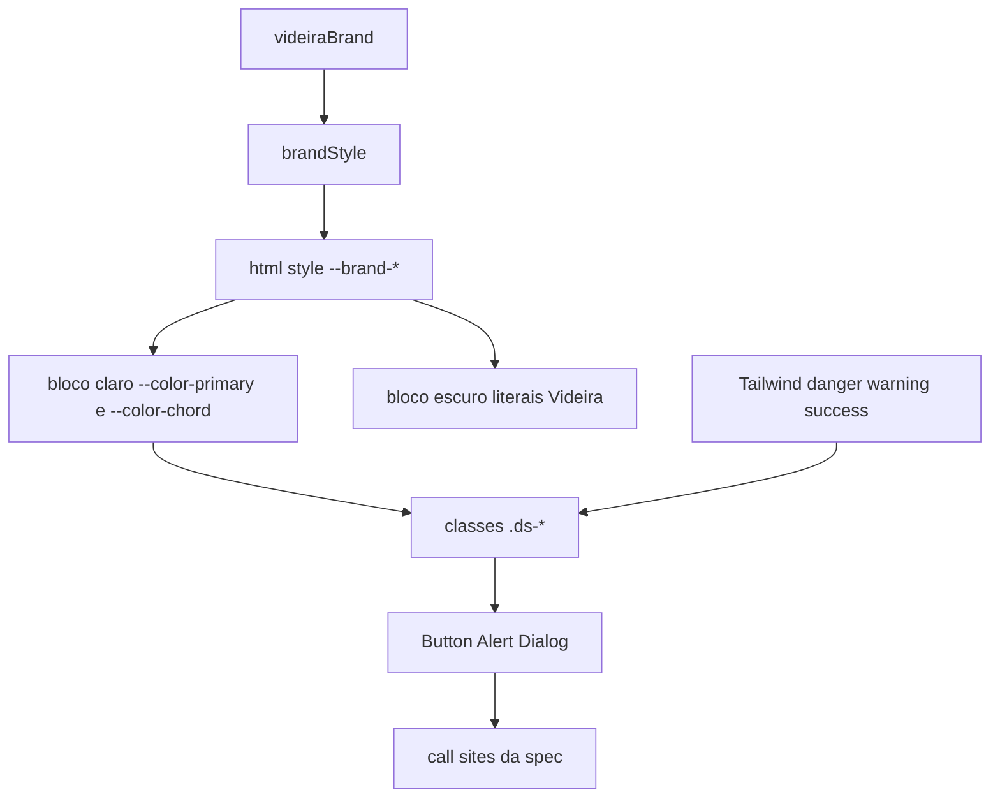

# Fundação do design system — Design

**Spec**: `.specs/features/design-foundation/spec.md`
**Status**: Approved

---

## Architecture Overview

A marca é um objeto TypeScript. O layout aplica o resultado de `brandStyle` como style do `<html>`. O CSS semântico claro aponta para essas variáveis. Componentes continuam usando classes Tailwind semânticas e `.ds-*`. Nenhum componente lê cor em JavaScript.

A spec já exige `brandStyle`, o style no `<html>` e `var(--brand-*)` no bloco claro (DS-01, DS-07, DS-08). Duas alternativas caem fora desses critérios:

- Classe `.brand-videira` só no CSS. Não há objeto com `name`, nem erro quando a chave falta.
- Contexto React com cor em JavaScript. A folha deixaria de ser a fonte do primário claro.

O tema escuro não lê `--brand-*` para primário e acorde. Status não faz parte da marca. Isso segue a AD-004: `Organization` não ganha coluna de marca.



---

## Code Reuse Analysis

### Existing Components to Leverage

| Component | Location | How to Use |
| --- | --- | --- |
| Tokens semânticos e `.ds-button` | `app/globals.css` | `Button` aplica a classe pronta. Danger copia o mesmo raio, padding, texto e anel. |
| Mapa Tailwind `primary` | `tailwind.config.ts` | `danger`, `warning` e `success` repetem `DEFAULT`, `hover`, `foreground`, `subtle`. |
| Layout raiz | `app/layout.tsx` | Ganha `style={brandStyle(videiraBrand)}`. `class="light"` e `data-theme="light"` ficam. |
| Teste do layout | `app/layout.test.tsx` | Um caso novo lê o `html` renderizado. |
| Dialog de seguidores | `components/setlists/followers-confirm-dialog.tsx` | Passa a renderizar `Dialog`. Título, frases e botões continuam aqui. |
| Menu do header | `components/layout/app-header-nav.tsx` | Não entra nesta feature. O padrão de `Escape` e overflow do `body` já existe ali e o `Dialog` repete a ideia, com foco devolvido. |

### Integration Points

| System | Integration Method |
| --- | --- |
| Prisma `Organization` | Nenhum. A marca não é persistida. |
| `getCurrentActor` | Nenhum. O layout segue resolvendo o ator só para a navegação. |
| Tailwind | Cores novas no `theme.extend.colors`. Sem plugin. |

---

## Components

### brandStyle

- **Purpose**: Validar a marca e devolver as cinco custom properties.
- **Location**: `lib/design/brand.ts`
- **Interfaces**:
  - `videiraBrand: BrandTheme` — constante da Videira. `name` é `"Videira"`.
  - `brandStyle(brand: object): BrandStyle` — lê só as cinco chaves de cor, na ordem `primary`, `primaryHover`, `primaryForeground`, `primarySubtle`, `chord`.
- **Dependencies**: nenhuma.
- **Reuses**: os canais HSL que hoje estão em `--videira-700`, `--videira-900`, `--videira-50` e `--neutral-0`.

Chave ausente (`undefined` ou fora do objeto) lança `Error` com `Brand color <key> is required.` Valor presente que não casa com `^\d{1,3}(?:\.\d+)? \d{1,3}% \d{1,3}%$` lança `Error` com `Brand color <key> must be HSL channels, for example "136 42% 33%".` A função não altera o objeto recebido. Chave extra, inclusive `name`, não aparece no retorno.

O retorno tem exatamente:

- `--brand-primary`
- `--brand-primary-hover`
- `--brand-primary-foreground`
- `--brand-primary-subtle`
- `--brand-chord`

### Layout

- **Purpose**: Injetar a marca Videira no documento.
- **Location**: `app/layout.tsx`
- **Interfaces**: o `<html>` recebe `style={brandStyle(videiraBrand)}`, mantém `className="light"` e `data-theme="light"`.
- **Dependencies**: `lib/design/brand.ts`
- **Reuses**: o layout atual. O texto "Videira Music" do header não muda.

### Folha e Tailwind

- **Purpose**: Ligar semânticos claros à marca e publicar status.
- **Location**: `app/globals.css`, `tailwind.config.ts`
- **Interfaces**: no bloco claro (`:root`, `:root.light`, `[data-theme="light"]`), `--color-primary`, `--color-primary-hover`, `--color-primary-foreground`, `--color-primary-subtle` e `--color-chord` passam a ser `var(--brand-*)`. `--color-focus` continua `var(--videira-500)`.
- **Dependencies**: as custom properties no `<html>`.
- **Reuses**: o bloco escuro existente. `--color-primary`, `--color-primary-hover`, `--color-primary-subtle` e `--color-chord` escuros permanecem literais (`134 45% 58%`, `134 50% 66%`, `136 28% 18%`, `134 45% 58%`).

Status entra nos dois blocos, com os canais de DS-11 e DS-12. Tailwind espelha `primary`:

```ts
danger: {
  DEFAULT: "hsl(var(--color-danger) / <alpha-value>)",
  hover: "hsl(var(--color-danger-hover) / <alpha-value>)",
  foreground: "hsl(var(--color-danger-foreground) / <alpha-value>)",
  subtle: "hsl(var(--color-danger-subtle) / <alpha-value>)",
}
```

O mesmo para `warning` e `success`.

`.ds-badge-accent` troca `bg-accent-subtle` / `text-accent` por `bg-primary-subtle` / `text-primary`. `.ds-button-danger` copia `.ds-button` com `bg-danger`, `text-danger-foreground` e `hover:bg-danger-hover`.

### Button

- **Purpose**: Aplicar uma classe de variante e repassar o botão nativo.
- **Location**: `components/ui/button.tsx`
- **Interfaces**:
  - `variant?: "primary" | "secondary" | "danger"` — default `"primary"`.
  - Demais props: `ButtonHTMLAttributes<HTMLButtonElement>`.
  - `type` default `"button"`.
- **Dependencies**: classes em `globals.css`.
- **Reuses**: `.ds-button`, `.ds-button-secondary`, `.ds-button-danger`.

Uma variante aplica uma classe só. `className` do chamador entra depois, sem apagar a variante. Não há `clsx` no projeto. A junção é filtro de string vazia e `join(" ")`.

### Alert

- **Purpose**: Mostrar erro de ação como texto danger.
- **Location**: `components/ui/alert.tsx`
- **Interfaces**: props de `HTMLParagraphElement`. Sem prop de tom.
- **Dependencies**: `text-danger`.
- **Reuses**: o `<p role="alert" className="text-sm text-red-600">` dos call sites.

Renderiza `<p role="alert" className="text-sm text-danger">`. `className` extra é acrescentado.

Call sites, só quando a mensagem é não vazia:

- `components/songs/song-trash-list.tsx`
- `components/setlists/setlist-editor.tsx` (anotação)
- `components/setlists/setlist-actions.tsx`
- `components/setlists/setlist-form.tsx`
- `components/groups/team-invite-form.tsx`

O hover destrutivo do editor (`setlist-editor.tsx` por volta da linha 833) troca `hover:border-red-600 hover:text-red-700` por `hover:border-danger hover:text-danger`. Esse controle não vira `Button`.

O submit "Enviar convite" vira `<Button type="submit" variant="primary">`.

### Dialog

- **Purpose**: Casco de modal com título, Escape, overlay, scroll e foco.
- **Location**: `components/ui/dialog.tsx`
- **Interfaces**:
  - `open: boolean`
  - `title: string`
  - `onClose: () => void`
  - `closeOnOverlay?: boolean` — default `true`
  - `children: ReactNode`
- **Dependencies**: React. Sem biblioteca de modal.
- **Reuses**: o overlay `fixed inset-0 z-50 bg-black/40` e o `.ds-card` do dialog de seguidores.

`open === false` renderiza `null`. O efeito roda só quando `open` muda. `onClose` fica numa ref, para um render do pai não reabrir o ciclo de foco.

Ao abrir: guarda `document.activeElement` se for `HTMLElement`, guarda `document.body.style.overflow`, define `overflow` como `hidden`, foca o painel (`tabIndex={-1}`).

Ao fechar ou desmontar: restaura o overflow anterior e chama `focus()` no elemento guardado. Sem elemento anterior, não chama `focus()`.

Escape no `document` chama `onClose` uma vez. Clique no overlay chama `onClose` só se `closeOnOverlay` é true. Clique no painel não fecha (`stopPropagation`).

O painel, não o overlay, carrega `role="dialog"`, `aria-modal="true"` e `aria-labelledby` apontando para o `id` do `<h2>`. O `id` vem de `useId()`.

### FollowersConfirmDialog

- **Purpose**: Manter a cópia e ligar `busy` ao casco.
- **Location**: `components/setlists/followers-confirm-dialog.tsx`
- **Interfaces**: as props atuais (`open`, `followerCount`, `busy`, `onConfirm`, `onCancel`).
- **Dependencies**: `Dialog`, `Button`.
- **Reuses**: as frases já montadas no arquivo.

`onClose` é `onCancel`. `closeOnOverlay` é `!busy`. Os dois botões ficam `disabled` quando `busy`. "Cancelar" é `variant="secondary"`. "Confirmar" é `variant="primary"`.

### Documento

- **Purpose**: Publicar o contrato da marca.
- **Location**: `docs/design-system.md`
- **Interfaces**: cita `videiraBrand` e as cinco chaves. Afirma que neutros, status, densidade mesa/estante, estrutura da cifra, raio e famílias tipográficas não mudam com a marca. Remove a frase `Status ainda não está em globals.css`.
- **Dependencies**: nenhuma.
- **Reuses**: a seção 3 do documento atual.

### Testes

| Critérios | Onde |
| --- | --- |
| DS-01 a DS-06 | `lib/design/brand.test.ts` |
| DS-07 | caso novo em `app/layout.test.tsx`, lendo o `html` do container |
| DS-08 a DS-15, DS-18, DS-33 | `lib/design/theme-contract.test.ts`, lendo `globals.css`, `tailwind.config.ts` e os `.tsx` de `app/` e `components/` |
| DS-16, DS-17, DS-31 | `components/ui/button.test.tsx` |
| DS-19 | `components/ui/alert.test.tsx` |
| DS-22 a DS-25, DS-34 a DS-36 | `components/ui/dialog.test.tsx` |
| DS-20, DS-21, DS-26, DS-27, DS-32, DS-37 | testes dos call sites e `components/setlists/followers-confirm-dialog.test.tsx` |
| DS-28 a DS-30 | o mesmo contrato de arquivo, em `theme-contract.test.ts` |

Os testes de arquivo procuram as declarações literais da spec. Não parseiam CSS.

---

## Data Models

### BrandTheme

```typescript
export type BrandTheme = {
  name: string;
  primary: string;
  primaryHover: string;
  primaryForeground: string;
  primarySubtle: string;
  chord: string;
};
```

**Relationships**: não há tabela. `videiraBrand` é a única instância. `brandStyle` aceita `object` para os testes de chave faltante poderem passar um objeto incompleto sem cast espalhado. Em runtime a checagem é a da spec.

### BrandStyle

```typescript
export type BrandStyle = {
  "--brand-primary": string;
  "--brand-primary-hover": string;
  "--brand-primary-foreground": string;
  "--brand-primary-subtle": string;
  "--brand-chord": string;
};
```

**Relationships**: vira o `style` do `<html>`. O bloco claro do CSS consome os mesmos nomes.

---

## Error Handling Strategy

| Error Scenario | Handling | User Impact |
| --- | --- | --- |
| Chave de cor ausente | `brandStyle` lança `Error` com `Brand color <key> is required.` | Nenhum. Só `videiraBrand` chega ao layout. O erro aparece no teste e, se alguém passar marca incompleta, na renderização do servidor. |
| Cor em hex ou `hsl(...)` | `brandStyle` lança `Error` com a mensagem de canais HSL | Nenhum na tela. A página não renderiza com cor inválida. |
| Dialog fecha sem foco anterior | Não chama `focus()` | O dialog some. Sem exceção. |
| `closeOnOverlay` falso | O clique no overlay não chama `onClose` | Com `busy`, a pessoa não dispensa o dialog de seguidores pelo fundo. Escape ainda cancela. |
| Mensagem de erro vazia | O call site não monta `Alert` | Nada de alerta vazio. |

---

## Risks & Concerns

| Concern | Location (file:line) | Impact | Mitigation |
| --- | --- | --- | --- |
| Dois modais próprios ficam de fora do casco novo | `components/setlists/setlist-editor.tsx:1012`, `app/songs/[songId]/song-detail.tsx:723` | O próximo dialog pode copiar o overlay antigo e perder foco | Esta feature não os migra. O casco novo é `components/ui/dialog.tsx`. O de anotação só troca o parágrafo de erro por `Alert`. |
| `text-accent` no link do convite | `components/groups/team-invite-form.tsx:87` | Quando `accent` deixar de ser o verde, esse link muda de cor sem querer | Fora da spec. `.ds-badge-accent` deixa de usar `accent`, que é o uso de badge. O link fica para uma feature de limpeza. |
| Primitivos `--videira-*` e `videiraBrand` podem divergir | `app/globals.css:12` | `--color-focus` ainda usa `--videira-500`. O primário claro não usa mais o primitivo | O teste de `brandStyle` trava os cinco canais da spec. O bloco claro não referencia `--videira-700` para primary nem chord. |
| Dialog de seguidores sem teste | `components/setlists/followers-confirm-dialog.tsx:1` | Regressão na frase de contagem e no `busy` | Arquivo de teste novo cobre DS-26, DS-27 e DS-37. |
| `setlist-editor.tsx` é grande | `components/setlists/setlist-editor.tsx:833` | Um refactor do editor junto com a troca de classe espalha o diff | Só mudam a classe de hover e o `<p>` de erro. O dialog de anotação permanece. |
| Efeito de foco reexecuta se `onClose` entrar nas dependências | `components/ui/dialog.tsx` (novo) | O dialog rouba o foco a cada render do pai | O efeito depende de `open`. `onClose` é lido por ref. |
| Tema claro forçado | `app/layout.tsx:49` | O bloco escuro não é o que o usuário vê | A spec manda manter `light`. O teste do layout afirma `data-theme="light"`. Não há seletor de tema nesta feature. |

---

## Tech Decisions

| Decision | Choice | Rationale |
| --- | --- | --- |
| Injeção da marca | `style` no `<html>` a partir de `brandStyle(videiraBrand)` | Atende DS-07. Uma igreja futura troca o argumento, não o JSX das telas. |
| Tema escuro | Literais atuais de primary e chord | DS-09. Preferência de tema está fora. |
| Forma do `Button` | Classe `.ds-*`, sem variante em estilo inline | Uma fonte visual. O componente não duplica padding e raio. |
| `onClose` no efeito | Ref | Evita o ciclo de foco descrito no risco. |
| Biblioteca de modal | Nenhuma | O casco cabe em um efeito. O projeto não tem Radix. |
| Decisão de projeto | AD-017 | A costura `--brand-*` vale para feature futura de whitelabel. |

> A AD-017 está em `.specs/STATE.md`. Nenhuma AD ativa foi superada. AD-004 continua: a marca não entra em `Organization`.
