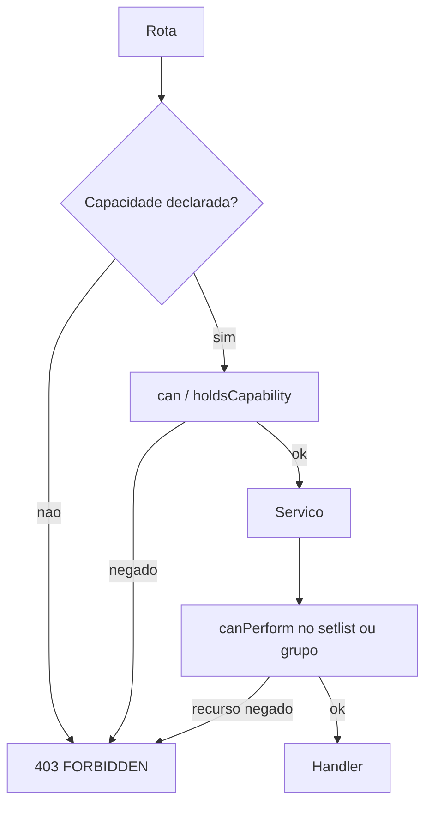

# Fundação de permissões Design

**Spec**: `.specs/features/permission-foundation/spec.md`
**Status**: Approved

---

## Architecture Overview

A decisão de acesso continua em dois lugares que já existem, com um contrato só para capacidades. `can` responde se o ator tem a capacidade na organização. `canPerform` continua a política do recurso de setlist e de grupo (AD-007, AD-008). A rota deixa de declarar `music:read` numa mutação: ela exige a capacidade grossa, e o serviço segue recusando o grupo errado.

Implicação mora em `holdsCapability`. Quem tem `import` satisfaz `music:write`. Quem tem `member.manage` satisfaz `users:invite`. Quem tem `setlists:all` satisfaz `setlists:led`. A carga do ator e o save do papel personalizado gravam o conjunto já fechado, para a navegação e o JSON baterem com a checagem.

`user.manage` e `role.manage` só entram no preset de código do `admin` (AD-014). Papel personalizado que as envie recebe `409 ADMIN_ONLY_CAPABILITY`. `users:manage` sai do catálogo. Id desconhecido na coluna JSON é ignorado na carga.

Não há migração de schema. Preset de papel de sistema continua no código, com `capabilities: []` na linha (AD-012).

### Portão por rota

Mutação de setlist declara `setlists:led`. O gestor e o admin passam porque o fechamento acrescenta `setlists:led` a quem tem `setlists:all`. O líder passa. O músico não. Criar setlist da igreja (`teamId` nulo) continua exigindo `setlists:all` dentro de `canPerform`, então o líder recebe `403` no serviço.

| Rota | Capacidade no portão |
| --- | --- |
| `GET` músicas, cifras, setlists | `music:read` |
| `PUT` música, cifra, `POST /api/song-charts`, `POST /api/migrations/local-data` | `music:write` |
| `POST`/`PATCH`/`DELETE` setlist, itens, clone, follow | `setlists:led` |
| `GET`/`POST /api/teams`, `PATCH /api/teams/:teamId` | `teams:manage` |
| `GET /api/members` | `member.manage` |
| `PUT /api/members/:userId/roles`, `POST .../deactivate` | `user.manage` |
| `PUT /api/teams/:teamId/leaders` | `teams:manage` |
| `GET`/`POST /api/invites`, `DELETE /api/invites/:id` | `users:invite` |
| `GET /api/access-requests`, approve, reject | `user.manage` |
| `GET`/`POST /api/roles`, `PATCH`/`DELETE /api/roles/:key` | `role.manage` |

`GET /api/roles` não serve a lista de rótulos da tela de membros. Essa leitura é `listRoleLabels`, no servidor da página, para quem tem `member.manage`, `user.manage` ou `role.manage`.

---

## Code Reuse Analysis

### Existing Components to Leverage

| Component | Location | How to Use |
| --- | --- | --- |
| `can` e `requirePermission` | `lib/auth/permissions.ts`, `lib/auth/api-guard.ts` | Estender o tipo `Permission`. Rotas de membros, convites, pedidos e papéis passam a chamar `requirePermission` antes do serviço. |
| `canPerform` | `lib/setlists/setlist-policy.ts` | Permanece a regra de leitura, edição e grupo. Não mover visibilidade para `can`. |
| `wrapPersistenceRoute` | `lib/persistence/persistence-api.ts` | Sem `permission`, responde `403` e não chama o handler. Apagar `withPersistenceRoute`, que hoje devolve o handler sem checagem. |
| `close` na carga | `lib/auth/load-actor.ts` | Depois de `unionCapabilities`, aplicar `closeCapabilities`. |
| Presets | `lib/auth/capabilities.ts` | Trocar o array. O gestor perde `users:manage` e ganha `member.manage`. |
| `LAST_ADMIN` | `lib/members/member-service.ts` | Manter a contagem. A autorização do ator passa a `user.manage` e, para incluir o papel `admin`, `role.manage`. |
| `AuthApiTestContext` | `lib/auth/auth-route-test-helpers.ts` | Matriz HTTP com `asUser` nos papéis já semeados. |
| Rótulos | `components/users/user-admin-shared.ts` | Novos rótulos e os quatro grupos do formulário. |
| Página de usuários | `app/usuarios/page.tsx`, `components/users/users-admin.tsx` | Buscar pedidos e catálogo só quando a capacidade existe. Esconder controles. |

### Integration Points

| System | Integration Method |
| --- | --- |
| Better Auth / `Actor` | Sem mudança de sessão. AD-011 e AD-007 ficam. A próxima request relê o banco. |
| Gate de origem da cifra | AD-013 fica. `import` continua o gate de origem nova. A implicação só faz quem importa também editar. |
| Pedido de acesso | `access-request-service` troca `users:manage` e `hasRole("admin")` por `user.manage` e `role.manage`. |
| Prisma `RoleDefinition.capabilities` | JSON livre. Sem migration. `users:manage` deixa de ser capacidade válida. |

---

## Components

### Catálogo e implicação

- **Purpose**: Lista fechada, presets, fechamento e a pergunta "este ator tem esta capacidade?".
- **Location**: `lib/auth/capabilities.ts`
- **Interfaces**:
  - `CAPABILITIES` inclui `member.manage`, `user.manage`, `role.manage` e não inclui `users:manage`
  - `ADMIN_ONLY_CAPABILITIES`: `user.manage`, `role.manage`
  - `closeCapabilities(capabilities): Capability[]` acrescenta a base de cada dependente presente
  - `holdsCapability(actor, capability, organizationId): boolean` vale se a capacidade está no ator ou se uma dependente que ele tem a exige
  - `systemCapabilities` devolve o preset já fechado
- **Dependencies**: `Actor` em `lib/auth/actor.ts`
- **Reuses**: `parseStoredCapabilities`, `unionCapabilities`

Presets fechados:

- `musician`: vazio
- `worship_leader`: `music:write`, `import`, `setlists:led`
- `manager`: `users:invite`, `member.manage`, `teams:manage`, `music:write`, `import`, `setlists:all`, `setlists:led`
- `admin`: o catálogo inteiro

### `can`

- **Purpose**: Portão por capacidade na organização. Não decide visibilidade de setlist.
- **Location**: `lib/auth/permissions.ts`
- **Interfaces**:
  - `Permission` = cada `Capability`, mais `music:read` e `users:grantRole`
  - `can(actor, permission, { organizationId, role? }): boolean`
  - `music:read`: ator usuário com ao menos um papel
  - `users:grantRole` com `role: "admin"`: `holdsCapability(..., "role.manage")`
  - `users:grantRole` com outro papel: `holdsCapability(..., "user.manage")`
  - capacidade armazenada: `holdsCapability`
- **Dependencies**: `holdsCapability`
- **Reuses**: a assinatura atual de `can`

### Save de papel

- **Purpose**: Recusar escalada e gravar o conjunto fechado.
- **Location**: `lib/roles/role-service.ts`
- **Interfaces**:
  - `createRole` e `updateRole` exigem `can(..., "role.manage")`
  - se a lista contém item de `ADMIN_ONLY_CAPABILITIES`, `409 ADMIN_ONLY_CAPABILITY` e não grava
  - senão grava `closeCapabilities` da lista válida
  - `listRoles` exige `role.manage`
  - `listRoleLabels(prisma, actor)` exige `member.manage`, `user.manage` ou `role.manage` e devolve só `key` e `label`
- **Dependencies**: `can`, `closeCapabilities`
- **Reuses**: `SYSTEM_ROLE`, `ROLE_IN_USE`, `ROLE_EXISTS`, auditoria `role.create` / `role.update` / `role.delete`

`capabilitiesMatchAdminPreset` e `ROLE_MATCHES_ADMIN` saem do caminho de escrita. A trava passa a ser `ADMIN_ONLY_CAPABILITY`.

### Membros e pedidos

- **Purpose**: Separar lista de membros da área de usuário.
- **Location**: `lib/members/member-service.ts`, `lib/access-requests/access-request-service.ts`
- **Interfaces**:
  - `listMembers`: `member.manage`
  - `setMemberRoles` e `deactivateMember`: `user.manage`. Incluir o papel `admin` também exige `role.manage`
  - `setTeamLeaders`: `teams:manage`, e o alvo continua precisando de `setlists:led`
  - approve, reject e listagem de pedidos: `user.manage`. Conceder o papel `admin` no pedido exige `role.manage`
- **Dependencies**: `can`
- **Reuses**: `LAST_ADMIN`, `reconcileSoleWorshipLeader` (continua olhando a chave `worship_leader`, AD-012)

### Portão HTTP

- **Purpose**: Rota sem capacidade não roda.
- **Location**: `lib/persistence/persistence-api.ts`, rotas em `app/api/**/route.ts`
- **Interfaces**:
  - `wrapPersistenceRoute` sem `permission` retorna `forbiddenResponse()` e não chama o handler
  - rotas de membros, convites, pedidos e papéis chamam `requirePermission` com a capacidade da tabela acima
  - o serviço mantém a própria checagem
- **Dependencies**: `requireActor`, `can`
- **Reuses**: corpo `{ error: { code: "FORBIDDEN" } }` e `401` `{ error: { code: "UNAUTHENTICATED" } }`

### Tela sem acesso

- **Purpose**: Uma frase só para URL autenticada sem capacidade.
- **Location**: `components/auth/no-access.tsx`
- **Interfaces**:
  - `NoAccess(): JSX` com título "Você não tem acesso a esta área" e frase "Peça acesso a um Gestor ou a um Admin."
  - sem botão e sem `fetch`
- **Dependencies**: nenhuma
- **Reuses**: `ds-card`

Quem usa:

- `app/import/page.tsx` quando o módulo está ligado, o ator é usuário e `can(import)` é falso. Sem sessão, redireciona para `/entrar`. Flag desligada continua `notFound`.
- `app/groups/page.tsx` quando falta `teams:manage`. Sem sessão, `/entrar`.
- `app/usuarios/page.tsx` quando falta `member.manage`, `users:invite` e `user.manage`. `?aba=papeis` sem `role.manage` também renderiza `NoAccess`, mesmo que o ator veja membros. `?aba=pedidos` sem `user.manage` cai na aba Membros.

### Aba Papéis

- **Purpose**: Grupo, dependência, prévia e capacidade de admin desabilitada.
- **Location**: `lib/auth/capability-toggle.ts`, `components/users/user-admin-shared.ts`, `components/users/roles-panel.tsx`
- **Interfaces**:
  - `CAPABILITY_GROUPS`: Biblioteca (`music:write`, `import`), Setlists (`setlists:led`, `setlists:all`), Grupos e pessoas (`users:invite`, `member.manage`, `teams:manage`), Administração (`user.manage`, `role.manage`)
  - `toggleCapability(selected, capability, checked): { next: Capability[]; warning: boolean }`
  - marcar dependente marca a base. Desmarcar a base desmarca o dependente e liga `warning`
  - frase do aviso: "Desmarcar esta capacidade também desmarca as que dependem dela."
  - caixas de `ADMIN_ONLY_CAPABILITIES` desabilitadas, com "Somente o papel Administrador pode ter esta capacidade."
  - com ao menos uma caixa marcada, "Este papel poderá:" mais os rótulos
- **Dependencies**: `CAPABILITY_LABELS`
- **Reuses**: `RolesPanel` e o POST/PATCH já existentes

Rótulos novos: `member.manage` "Gerenciar membros", `user.manage` "Área de usuário", `role.manage` "Gerenciar papéis". O rótulo antigo de `users:manage` sai.

### Página de usuários e navegação

- **Purpose**: O gestor vê membros e convites. O admin vê o resto.
- **Location**: `app/usuarios/page.tsx`, `components/users/users-admin.tsx`, `components/users/members-panel.tsx`, `app/layout.tsx`
- **Interfaces**:
  - `canChangeRoles` quando `user.manage`. Sem isso, o painel mostra os papéis em texto e não mostra Desativar
  - aba Pedidos só com `user.manage`. Aba Papéis só com `role.manage`
  - a página do gestor não chama `listPendingAccessRequests` nem `listRoles`
  - link Usuários: `member.manage` ou `users:invite` ou `user.manage`
  - link Importar: `import`. Link Grupos: `teams:manage`
- **Dependencies**: `can`, `NoAccess`, `listRoleLabels`
- **Reuses**: `UsersAdmin`

---

## Data Models (if applicable)

Sem tabela nova e sem migration.

`RoleDefinition.capabilities` continua `Json`. Valor gravado de papel personalizado é a lista fechada, sem `user.manage` e sem `role.manage`. Papel de sistema continua com `[]` na linha. O preset vem de `systemCapabilities`.

Um JSON antigo com `users:manage` não produz `users:manage`, `member.manage` nem `user.manage` na carga.

---

## Error Handling Strategy

| Error Scenario | Handling | User Impact |
| --- | --- | --- |
| Sem sessão na API | `401 UNAUTHENTICATED` | Nenhum dado |
| Sem sessão na página | redirect `/entrar` | Tela de entrar |
| Capacidade ausente na rota ou no serviço | `403 FORBIDDEN`, sem log novo | Tela sem acesso na página. Mensagem já usada na API |
| Capacidade exclusiva no papel personalizado | `409 ADMIN_ONLY_CAPABILITY`, não grava, não audita a tentativa | A aba mostra "Somente o papel Administrador pode ter esta capacidade." |
| Capacidade desconhecida | `400 INVALID_ROLE`, não grava | Mensagem já usada |
| Último admin | `409 LAST_ADMIN`, estado intacto | Frase já usada |
| `?aba=papeis` sem `role.manage` | página `NoAccess` | Título e frase da spec |
| Import com flag desligada | `notFound` | Página inexistente, como hoje |

---

## Risks & Concerns

| Concern | Location (file:line) | Impact | Mitigation |
| --- | --- | --- | --- |
| Mutação de setlist e grupo declarada como `music:read` | `app/api/setlists/route.ts:121`, `app/api/teams/route.ts:95` | Músico passa do portão e só cai no serviço | Trocar a capacidade declarada. O serviço permanece |
| `withPersistenceRoute` não checa nada | `lib/persistence/persistence-api.ts:77` | Um caller futuro fura o portão | Apagar a função. `wrapPersistenceRoute` sem `permission` responde `403` |
| `listRoles` hoje é a única leitura de rótulos e exige gerir usuários | `lib/roles/role-service.ts:87`, `app/usuarios/page.tsx:49` | Gestor levaria `403` ao abrir membros | `listRoleLabels` separado. `GET /api/roles` fica em `role.manage` |
| AD-012 deixava o gestor aprovar pedido | `lib/access-requests/access-request-service.ts:111` | Conflito com PERM-03 | AD-014. O serviço exige `user.manage` |
| Testes de `ROLE_MATCHES_ADMIN` e de `users:manage` no gestor | `lib/roles/role-service.test.ts:122`, `lib/auth/permissions.test.ts:19` | A suíte quebra se alguém enfraquecer o assert | Atualizar o resultado esperado para `ADMIN_ONLY_CAPABILITY` e para o preset novo. Não apagar o caso |
| JSON antigo com `users:manage` perde poder sem aviso | `lib/auth/capabilities.ts:67` | Papel personalizado antigo deixa de gerir usuários | PERM-25. Sem migration. O id ignorado é o comportamento |
| Página de grupos fala "administrador" | `app/groups/page.tsx:39` | Músico vê texto errado | `NoAccess` antes de `listTeams` |
| Duas funções de política | `lib/auth/permissions.ts:13`, `lib/setlists/setlist-policy.ts:114` | Regra nova cair num lado só | Capacidade em `can`. Recurso de setlist em `canPerform`. Os dois usam `holdsCapability` |

---

## Tech Decisions (only non-obvious ones)

| Decision | Choice | Rationale |
| --- | --- | --- |
| Onde vive a regra de setlist | `canPerform` permanece. `can` não absorve visibilidade | AD-007 e AD-008. O furo da spec é o portão declarar `music:read`, não a segunda função |
| Onde vive a implicação | `holdsCapability` na checagem e `closeCapabilities` na carga e no save | PERM-17 vale mesmo para ator montado em teste, sem passar por `loadActor` |
| Escalada | `409 ADMIN_ONLY_CAPABILITY` no lugar de `ROLE_MATCHES_ADMIN` | AD-014. Um papel com todas as capacidades não exclusivas grava |
| Rótulos para o gestor | Função de servidor, não `GET /api/roles` | PERM-04 fecha essa rota. A tela de membros ainda precisa do nome do papel |
| URL `?aba=papeis` | `NoAccess` na página inteira | PERM-35. `?aba=pedidos` sem `user.manage` volta para Membros, porque a spec só manda omitir a aba |
| Log do `403` | Não gravar | Fora de escopo. O código de erro permanece |
| Projeto | AD-014 estreita a cláusula de aprovação da AD-012 | Decisão de quem libera acesso. O resto da AD-012 fica ativo |
