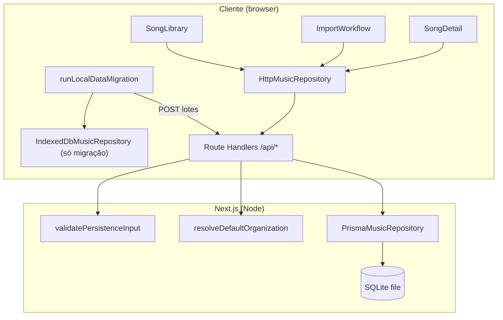

# Persistência no servidor (SQLite) - Design

**Spec:** `.specs/features/server-persistence/spec.md`  
**Context:** `.specs/features/server-persistence/context.md`  
**Status:** Complete

## Architecture Overview

A UI continua atrás do contrato `MusicRepository`. O cliente usa `HttpMusicRepository` (fetch com timeout de 15 s). O servidor expõe Route Handlers Node.js que validam entrada, resolvem a organização `default` e delegam a `PrismaMusicRepository` (marcado `server-only`). O IndexedDB permanece apenas como origem de leitura na migração única; `IndexedDbMusicRepository` não é mais instanciado pela UI.

Abordagens consideradas:

1. **Prisma + SQLite nativo + rotas REST, escolhida:** um `schema.prisma` portátil, migrations versionadas, contrato compartilhado testável e caminho claro para Postgres/Turso (adapter libSQL opcional).
2. **Drizzle + SQLite:** menos opinião, mas duplica padrão de migrations e não está alinhado à AD-004 (Prisma).
3. **Server Actions sem HTTP explícito:** menos testável para `HttpMusicRepository` e mistura validação com RSC; a spec exige rotas e testes de handler.



## Code Reuse Analysis

### Existing Components to Leverage

| Component | Location | How to Use |
| --- | --- | --- |
| `MusicRepository` / `InMemoryMusicRepository` | `lib/persistence/music-repository.ts` | Contrato inalterado; InMemory ganha canonicalização de `originUrl`; suíte de contrato compartilhada. |
| `IndexedDbMusicRepository` | `lib/persistence/music-database.ts` | Manter para migração; extrair `canonicalizeOriginUrl` para módulo compartilhado usado também no Prisma. |
| `saveImportedChart` + fila serializada | `lib/import/save-imported-chart.ts` | Continua no cliente com qualquer `MusicRepository`; sem mudança de assinatura. |
| Envelope de erro | `app/api/imports/cifraclub/route.ts` | `{ error: { code, message } }` + `issues` em `422`; helper compartilhado em `lib/persistence/persistence-api.ts`. |
| Mapeamento seed | `lib/data/songs.ts` | Reutilizar `toSong` (ou extrair função pura) no `prisma/seed.ts`; a UI deixa de mesclar JSON no cliente. |
| `normalized()` (NFKD) | `components/import/import-workflow.tsx` | Extrair para `lib/persistence/search-text.ts` e usar no Prisma ao gravar `searchText`. |
| Tipos de domínio | `types/music.ts` | Resposta da API devolve objetos de domínio sem colunas internas. |
| Testes co-localizados | `*.test.ts`, `vitest.config.ts` | Mesmo padrão chart-import; fake-indexeddb na migração. |

### Integration Points

| System | Integration Method |
| --- | --- |
| SQLite | `DATABASE_URL=file:…` via env; Prisma 6.x com driver SQLite embutido (sem adapter obrigatório). |
| Turso (opcional) | `@prisma/adapter-libsql` + mesma schema; documentado em P3, não bloqueia MVP local. |
| Next App Router | Route Handlers com `runtime = "nodejs"`, `dynamic = "force-dynamic"`. |
| IndexedDB | Leitura única via exportador dedicado; marcador `localStorage` `videira-music:indexeddb-migration`. |
| `import-access` (futuro) | Middleware/guard injetável nas rotas de escrita de cifra com `origin`; nesta entrega rotas abertas em dev. |

## Components

### Persistence Utilities

- **Purpose:** Canonicalizar `originUrl`, calcular `searchText` e mapear linhas Prisma ↔ domínio.
- **Location:** `lib/persistence/persistence-utils.ts`, `lib/persistence/search-text.ts`
- **Interfaces:**
  - `canonicalizeOriginUrl(url: string): string`
  - `buildSongSearchText(song: Song): string`
  - `toDomainSong(row): Song`, `toDomainChart(row): ChordChart`
- **Dependencies:** `types/music.ts`
- **Reuses:** lógica hoje em `music-database.ts` e `import-workflow.tsx`.

### Persistence Validation

- **Purpose:** Validar corpos de escrita (PER-05), limites 2 MiB / 8 MiB, faixas `tempo`/`capo`, IDs e enums na aplicação.
- **Location:** `lib/persistence/validate-persistence-input.ts`
- **Interfaces:**
  - `parseSongJson(body: unknown): Song | ValidationFailure`
  - `parseChartJson(body: unknown): ChordChart | ValidationFailure`
  - `parseSongChartBody(body: unknown): { song?: Song; chart: ChordChart } | ValidationFailure`
  - `parseMigrationBatch(body: unknown): { songs: Song[]; charts: ChordChart[] } | ValidationFailure`
- **Dependencies:** tipos de domínio; sem Prisma.
- **Reuses:** padrões de validação da rota Cifra Club.

### RepositoryError (cliente)

- **Purpose:** Propagar códigos HTTP da API para a UI (PER-06).
- **Location:** `lib/persistence/repository-error.ts`
- **Interfaces:** `class RepositoryError extends Error { code: string; status: number; issues?: … }`
- **Dependencies:** nenhuma.
- **Reuses:** mensagens de erro da spec.

### Prisma Client Factory

- **Purpose:** Singleton server-only, falha clara se `DATABASE_URL` ausente, PRAGMAs SQLite (PER-09).
- **Location:** `lib/persistence/prisma-client.ts` (`import "server-only"`)
- **Interfaces:** `getPrisma(): PrismaClient`, `withSqlitePragmas(client): Promise<void>`
- **Dependencies:** `@prisma/client`, env.
- **Reuses:** AD-004.

### Organization Scope

- **Purpose:** Resolver `organizationId` da org `slug = "default"`; ignorar tenant vindo do cliente (PER-07).
- **Location:** `lib/persistence/organization-scope.ts`
- **Interfaces:** `getDefaultOrganizationId(prisma): Promise<string>`
- **Dependencies:** Prisma.
- **Reuses:** seed.

### PrismaMusicRepository

- **Purpose:** Implementação server-only do contrato `MusicRepository`.
- **Location:** `lib/persistence/prisma-music-repository.ts`
- **Interfaces:** métodos do contrato; upsert por `id`; unicidade `(organizationId, originUrl)`; `saveSongAndChart` em `$transaction`.
- **Dependencies:** Prisma, utilities, organization scope.
- **Reuses:** regras do IndexedDB (canonicalização, atomicidade).

### Persistence API Helpers

- **Purpose:** Envelope JSON, leitura de corpo com limite de bytes, mapeamento Prisma → HTTP (`503`, `409`, etc.).
- **Location:** `lib/persistence/persistence-api.ts`
- **Interfaces:**
  - `persistenceError(status, code, message, extras?)`
  - `readJsonBody(request, maxBytes): Promise<unknown>`
  - `withPersistenceRoute(handler): RouteHandler` (timing + log PER-16, sem corpo musical)
- **Dependencies:** `RepositoryError` codes alinhados à spec.

### Route Handlers

- **Purpose:** Expor REST mapeado 1:1 ao `HttpMusicRepository`.
- **Location:**

| Método | Rota | Handler |
| --- | --- | --- |
| GET | `/api/songs` | lista org |
| GET | `/api/songs/[songId]` | detalhe ou 404 |
| PUT | `/api/songs/[songId]` | upsert song |
| GET | `/api/songs/[songId]/charts` | charts do song |
| GET | `/api/charts?originUrl=` | lookup canônico |
| PUT | `/api/charts/[chartId]` | upsert chart |
| POST | `/api/song-charts` | transação song+chart |
| POST | `/api/migrations/local-data` | lote idempotente |

- **Dependencies:** validation, `PrismaMusicRepository`, org scope.
- **Reuses:** factory `createXHandler(deps)` testável como Cifra Club.

### HttpMusicRepository

- **Purpose:** Adaptador cliente do contrato via `fetch`.
- **Location:** `lib/persistence/http-music-repository.ts`
- **Interfaces:** implementação `MusicRepository`; `AbortSignal.timeout(15_000)`; `404` de busca → `undefined`; demais erros → `RepositoryError`.
- **Dependencies:** `RepositoryError`, URLs relativas `/api/…`.
- **Reuses:** contrato existente.

### Local Data Migration (cliente)

- **Purpose:** Ler IndexedDB, particionar lotes ≤ 8 MiB, chamar migração, gerir marcador e mensagens (PER-12, PER-13).
- **Location:** `lib/persistence/local-data-migration.ts`
- **Interfaces:**
  - `exportIndexedDbLocalData(): Promise<{ songs; charts }>`
  - `runLocalDataMigration(options): Promise<MigrationResult>`
- **Dependencies:** `IndexedDbMusicRepository` ou leitura direta do mesmo schema IDB.
- **Reuses:** constantes de DB em `music-database.ts`.

### Seed

- **Purpose:** Criar org `default` + 63 músicas idempotentes (PER-11).
- **Location:** `prisma/seed.ts`
- **Dependencies:** `data/musicas.json`, mapeamento `toSong`.
- **Reuses:** `lib/data/songs.ts`.

### Contract Test Suite

- **Purpose:** Mesmos casos para InMemory, Prisma (SQLite temp file), Http (handlers in-process) (PER-14).
- **Location:** `lib/persistence/music-repository.contract.test.ts`
- **Dependencies:** Vitest, helpers de DB temporário.
- **Reuses:** dados sintéticos sem letra real (AD-003).

## Data Models

### Prisma Schema (portável PER-08)

```prisma
model Organization {
  id        String   @id
  slug      String   @unique
  name      String
  createdAt DateTime @default(now())
  updatedAt DateTime @updatedAt
  songs     Song[]
  charts    ChordChart[]
}

model Song {
  id             String   @id
  organizationId String
  organization   Organization @relation(fields: [organizationId], references: [id])
  title          String
  label          String
  artist         String?
  genre          String?
  defaultKey     String?
  alternateKeys  Json     // string[]
  notes          String?
  meta           String
  searchText     String
  createdAt      DateTime @default(now())
  updatedAt      DateTime @updatedAt
  charts         ChordChart[]

  @@index([organizationId])
}

model ChordChart {
  id             String   @id
  organizationId String
  organization   Organization @relation(fields: [organizationId], references: [id])
  songId         String
  song           Song     @relation(fields: [songId], references: [id])
  title          String?
  format         String   // lyrics | grid — validado na app
  key            String
  timeSignature  String
  tempo          Int?
  capo           Int?
  sections       Json
  source         String?
  origin         Json?
  originUrl      String?  // canônica, indexada
  schemaVersion  Int      @default(1)
  createdAt      DateTime @default(now())
  updatedAt      DateTime @updatedAt

  @@unique([organizationId, originUrl])
  @@index([organizationId, songId])
}
```

**Relacionamentos:** `Song` e `ChordChart` pertencem a uma `Organization`. FK `songId` com `onDelete` restrict (sem delete na API). `originUrl` nulo para cifras sem `origin`.

**IDs:** novos UUID v7 gerados no cliente antes do `PUT`/`POST` (PER-08 AC 4); seed preserva `"1"`…`"63"`; migração preserva `song-local-*` / `chart-local-*`.

### SQLite PRAGMAs (conexão)

Executados uma vez por processo após conectar:

- `PRAGMA foreign_keys = ON`
- `PRAGMA journal_mode = WAL`
- `PRAGMA busy_timeout = 5000`

Erros mapeados para `503 DATABASE_UNAVAILABLE` + `Retry-After: 2`.

## Error Handling Strategy

| Error Scenario | Handling | User Impact |
| --- | --- | --- |
| JSON inválido | `400 INVALID_REQUEST` | Mensagem genérica; import mantém draft. |
| Corpo > 2 MiB (escrita) / > 8 MiB (migração) | `413 PAYLOAD_TOO_LARGE` | Nada gravado. |
| Validação de domínio | `422 VALIDATION_FAILED` + `issues` | Campo indicado; draft preservado no import. |
| Song ausente para chart | `404 SONG_NOT_FOUND` | Sem gravação parcial. |
| `originUrl` duplicada | `409 ORIGIN_URL_CONFLICT` + `existingChartId` | Abrir cifra existente no import (fluxo atual). |
| DB indisponível / busy | `503` + `Retry-After` | Biblioteca/detalhe: retry; import: erro sem navegar. |
| `DATABASE_URL` ausente | `503 DATABASE_NOT_CONFIGURED` | Mesmo padrão. |
| Falha inesperada | `500 PERSISTENCE_FAILED` | Detalhe: "Tentar novamente"; sem stack no corpo. |
| Rede / timeout 15 s | `RepositoryError NETWORK_TIMEOUT` | UI não navega após save falho. |
| Leitura detalhe falhou | Estado `storage-error` | Texto PER-06 AC 14; **sem** fallback ao seed JSON. |

## Risks & Concerns

| Concern | Location | Impact | Mitigation |
| --- | --- | --- | --- |
| Biblioteca mescla seed + IndexedDB | `components/songs/song-library.tsx:50-55` | Duplicatas e fonte errada após deploy | Listar só `repository.listSongs()`; seed só via banco. |
| Detalhe usa `seedSong` e fallback em erro | `app/songs/[songId]/page.tsx:19`, `song-detail.tsx:64-70` | Mascara falha do servidor | Remover prop seed na página; erro explícito PER-06. |
| `InMemory` não canonicaliza `#` | `lib/persistence/music-repository.ts:54-56` | Contrato inconsistente | Corrigir na suíte PER-14. |
| `generateStaticParams` só seed | `app/songs/[songId]/page.tsx:11-14` | IDs novos 404 no build estático | Dynamic route ou params vazios + resolução client/server via API. |
| Prisma ainda não no projeto | `package.json` | Versão e Json SQLite | Fixar Prisma ≥ 6.2; Json nativo; adapter só se Turso. |
| Escritas abertas até `import-access` | spec PER ordem deploy | Abuso em deploy público | Documentar; gate vem na feature seguinte. |
| Duas abas migrando | spec edge case | Corrida no marcador | Idempotência no servidor; marcador só após sucesso total. |
| Página home ainda cita JSON local | `app/page.tsx:46` | Copy desatualizada | Atualizar na fase UI/docs. |

## Tech Decisions

| Decision | Choice | Rationale |
| --- | --- | --- |
| ORM / DB | Prisma 6.x + SQLite file via `DATABASE_URL` | AD-004; migrations versionadas; Postgres depois. |
| Json no SQLite | Tipo `Json` do Prisma (≥ 6.2) | Suporte oficial; sem serializar manualmente `sections`. |
| Driver adapter | **Não** no MVP local; **libSQL** documentado para Turso | Adapter só exigido com query compiler / Turso; file SQLite usa driver embutido. |
| UUID v7 | Pacote `uuid` (v7) ou helper dedicado no cliente | IDs ordenáveis; retry idempotente com mesmo id. |
| Rotas testáveis | `createHandler(deps)` exportado | Mesmo padrão Cifra Club; Http tests in-process. |
| Org tenant | Sempre `default` no servidor | PER-07; prepara multi-tenant sem auth. |
| Seed idempotente | `createMany` skip duplicates ou upsert só insert | PER-11 AC 3 — nunca sobrescrever edições. |
| Logging | Wrapper `withPersistenceRoute` | PER-16; rota, status, code, durationMs. |
| import-access | Hook stub `assertImportWriteAllowed(chart)` nas rotas de chart com `origin` | Implementação real na feature `import-access`; noop até lá. |

## Prisma / SQLite (verificação Design)

- **Json no SQLite:** suportado desde Prisma **6.2.0**; usar `alternateKeys`, `sections`, `origin` como `Json`.
- **Driver adapter:** **não obrigatório** para `provider = "sqlite"` + arquivo local; usar `@prisma/adapter-libsql` apenas se `DATABASE_URL` apontar para Turso/libSQL.
- **Enums de banco:** não usar; validar `format`, `SectionType`, `origin.kind` na aplicação (PER-08).
