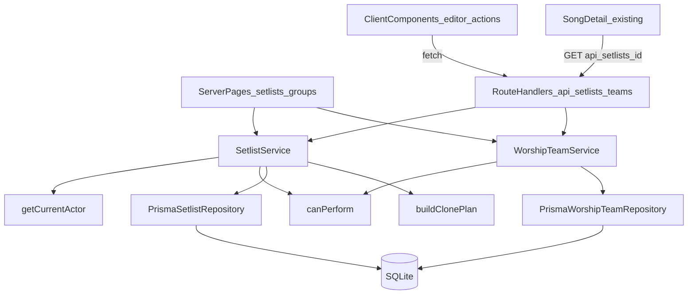
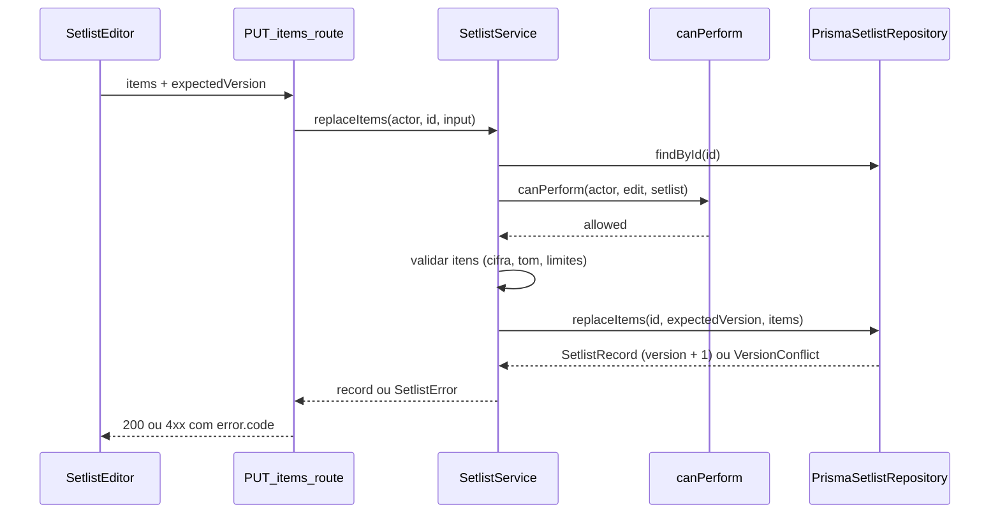

# Setlists (fase 1) Design

**Spec**: `.specs/features/setlists/spec.md`
**Context**: `.specs/features/setlists/context.md`
**Status**: Approved

Conforma as decisões ativas AD-002, AD-004, AD-005, AD-006, AD-007 e AD-008 de `.specs/STATE.md`. A AD-003 foi substituída pela AD-006.

---

## Architecture Overview

As páginas são Server Components: chamam `SetlistService` direto, com o `Actor` de `getCurrentActor()`. As escritas passam pelas rotas `/api/setlists` e `/api/teams`, chamadas por componentes de cliente (editor, seguir, clonar, status). Rotas e páginas usam o mesmo serviço, e o serviço é o único lugar que chama `canPerform` (abordagem A, aprovada pelo usuário).



O fluxo de uma escrita:



---

## Code Reuse Analysis

### Existing Components to Leverage

| Component | Location | How to Use |
| --- | --- | --- |
| `Actor`, `isOrganizationAdmin`, `teamRoleOf` | `lib/auth/actor.ts` | Entrada de `canPerform`. |
| `getCurrentActor` | `lib/auth/current-actor.ts` | Único ponto de identidade (AD-007). |
| Seed de identidades | `lib/auth/simulated-identities.ts` | Fixtures dos testes de política, serviço e rota. |
| `getPrisma`, `ensureSqlitePragmas`, `isDatabaseConfigured`, `resetPrismaClientForTests` | `lib/persistence/prisma-client.ts` | Acesso ao banco nas dependências de rota. |
| `persistenceError`, `readJsonBody`, `wrapPersistenceRoute` | `lib/persistence/persistence-api.ts` | Mesmo formato de erro, leitura de corpo com limite e log de falhas. |
| `mapPersistenceFailure` | `lib/persistence/persistence-route-deps.ts` | `503` de banco ausente ou ocupado. |
| `createTempDatabaseUrl`, `createTestPrismaClient` | `lib/persistence/test-temp-db.ts` | Banco real por teste (repositório, serviço e rotas). |
| `canonicalizeOriginUrl` | `lib/persistence/origin-url.ts` | Casar `originUrl` no clone entre igrejas. |
| `toPrismaSongCreate` e conversores | `lib/persistence/persistence-utils.ts` | Copiar música e cifra no clone. |
| `parseKeyRoot` | `lib/chords/transpose-chord.ts:27` | Base de `isTransposableKey`. |
| `buildSetlistSongHref`, `parseSetlistSongContext` | `lib/songs/setlist-song-context.ts` | Links de `/play` e vizinhos no detalhe da música. |
| `GET /api/songs/{songId}/charts` | `app/api/songs/[songId]/charts/route.ts` | O editor busca as cifras da música escolhida. |
| `GET /api/songs` | `app/api/songs/route.ts` | O editor lista o catálogo para adicionar músicas. |
| Classes `ds-*` e tokens | `app/globals.css`, `docs/design-system.md` | Todas as telas novas. |

### Integration Points

| System | Integration Method |
| --- | --- |
| Header | `app/layout.tsx` vira `async`, chama `getCurrentActor()` e mostra "Grupos" só para o admin (GRP-01). |
| Detalhe da música | `SongDetail` recebe um `SetlistNeighborsNav` que chama `GET /api/setlists/{id}` e mostra "Anterior" e "Próxima" (SET-12). Depende do trabalho em andamento em `song-detail.tsx`. |
| Preferência de transposição | Escopo `setlist-item` usa `setlistId` e `itemId` (`lib/songs/transpose-preference.ts:32`); por isso os ids de item são preservados ao reordenar. |
| Catálogo | `SetlistItem` tem FK para `Song` e `ChordChart`; o clone entre igrejas cria registros novos no catálogo de destino. |

---

## Components

### `isTransposableKey`

- **Purpose**: Validar `selectedKey` (SET-05).
- **Location**: `lib/chords/transpose-chord.ts`
- **Interfaces**: `isTransposableKey(key: string): boolean`. É verdadeiro quando `parseKeyRoot(key)` existe e está em `SHARP_NOTES` ou `FLAT_NOTES`, e o resto é vazio ou `m`.
- **Reuses**: `parseKeyRoot`, `noteIndex`.

### Tipos de setlist

- **Location**: `types/setlist.ts`. Substitui `Setlist` e `SetlistItem` de `types/music.ts`, que hoje não têm uso fora do próprio arquivo. `SetlistId` continua em `types/music.ts`.
- **Interfaces**: ver Data Models.

### `canPerform` (política)

- **Purpose**: A única decisão de acesso para setlists e grupos (SET-23, SET-24).
- **Location**: `lib/setlists/setlist-policy.ts`
- **Interfaces**:
  - `canPerform(actor: Actor, action: SetlistAction, target: PolicyTarget): boolean`
  - `type SetlistAction = "read" | "create" | "edit" | "changeStatus" | "delete" | "follow" | "clone" | "manageTeams"`
  - `type PolicyTarget =`
    - `| { type: "setlist"; setlist: SetlistAccess }` para `read`, `edit`, `changeStatus` e `delete`;
    - `| { type: "destination"; organizationId: string; teamId: string | null }` para `create`, `follow` e `clone` (com `teamId` nulo, o destino é a igreja);
    - `| { type: "organization"; organizationId: string }` para `manageTeams`.
  - `type SetlistAccess = { organizationId; ownerTeamId: string | null; status; visibility; deletedAt: string | null; followerTeamIds: string[] }`
- **Regras de `read`**:
  - excluído é sempre negado;
  - `draft` e `private` exigem `edit`;
  - `team` libera quem pode editar, os membros do grupo dono e quem está num grupo seguidor;
  - `organization` libera usuários da mesma igreja e o anônimo quando a igreja é `DEFAULT_ORGANIZATION_ID`;
  - `public` publicado libera qualquer um.
- **Dependencies**: `lib/auth/actor.ts`, `DEFAULT_ORGANIZATION_ID`.
- **Testes**: uma tabela com cada ação × admin, líder do dono, líder de outro grupo, membro, membro de grupo seguidor, anônimo e usuário de outra igreja.

### `PrismaSetlistRepository`

- **Purpose**: Persistência de setlists, itens e seguidores, sem regra de acesso.
- **Location**: `lib/setlists/prisma-setlist-repository.ts` (contrato em `lib/setlists/setlist-repository.ts`).
- **Interfaces**:
  - `findById(id): Promise<SetlistRecord | undefined>`: inclui excluídos, itens em ordem (com a `ChordChart` resumida: `key`, `originUrl`, `hasOrigin`) e `followerTeamIds`.
  - `list(filter: { organizationId; ownerTeamId?: string | null; includeArchived: boolean }): Promise<SetlistRecord[]>`: sem os excluídos.
  - `listFollowedBy(teamId): Promise<SetlistRecord[]>`: inclui excluídos, para o serviço montar o "indisponível".
  - `create(input: NewSetlist): Promise<SetlistRecord>`
  - `updateMeta(id, expectedVersion, patch: SetlistMetaPatch): Promise<SetlistRecord>`
  - `replaceItems(id, expectedVersion, items: NewSetlistItem[]): Promise<SetlistRecord>`
  - `softDelete(id, expectedVersion): Promise<void>`
  - `follow(setlistId, teamId)`, `unfollow(setlistId, teamId)`: idempotentes, via `upsert` e `deleteMany`.
  - `applyClonePlan(plan: ClonePlan): Promise<SetlistRecord>`: tudo numa `$transaction`.
- **Versão**: toda escrita faz `updateMany({ where: { id, version: expectedVersion, deletedAt: null }, data: { version: { increment: 1 }, ... } })` dentro da transação. `count === 0` lança `SetlistVersionConflictError` com a versão atual. Em `replaceItems`, isso vem antes de `deleteMany` e `createMany` na mesma `$transaction`.
- **Reuses**: o padrão de `lib/persistence/prisma-music-repository.ts` (`$transaction` na linha 118).

### `buildClonePlan` (puro)

- **Purpose**: Calcular o que o clone cria (SET-21, SET-22) sem tocar no banco.
- **Location**: `lib/setlists/clone-plan.ts`
- **Interfaces**: `buildClonePlan(input: { source: SetlistRecord; sourceCatalog: { songs: Song[]; charts: ChordChart[] }; target: { organizationId; ownerTeamId: string | null }; existingTargetChartsByOriginUrl: Map<string, { chartId; songId }>; newId: () => string }): ClonePlan`
- **Regras**:
  - Na mesma igreja, `songsToCreate` e `chartsToCreate` ficam vazios.
  - Entre igrejas, a cifra com `originUrl` canônico já existente no destino é reaproveitada, com a música dela. Senão, música e cifra são copiadas com ids novos e `sourceOrganizationId`, e a mesma música de origem é copiada uma única vez por clone.
  - Os itens recebem ids novos; o setlist novo sai como `draft`, com mesmo título, `eventType` e `notes`, `eventAt` nulo, e visibilidade `team` ou `organization`.
- **Reuses**: `canonicalizeOriginUrl`.

### `SetlistService`

- **Purpose**: Orquestrar `Actor`, política, validação e repositório para rotas e páginas.
- **Location**: `lib/setlists/setlist-service.ts`
- **Interfaces** (todas recebem `actor` e lançam `SetlistError { status, code, extras }`):
  - `listTab(actor, { team: WorshipTeam | null; tab }): Promise<SetlistSummary[] | FollowedEntry[]>` (SET-15)
  - `getReadable(actor, id): Promise<SetlistView>`: lança `404 SETLIST_NOT_FOUND` para inexistente, excluído e ilegível (SET-13).
  - `create(actor, input)`, `updateMeta(actor, id, input)`, `replaceItems(actor, id, input)`, `delete(actor, id, input)`
  - `follow(actor, id, teamId)`, `unfollow(actor, id, teamId)`, `clone(actor, id, destination)`
- **Regras que ficam aqui**:
  - transições de status (SET-08);
  - `INVALID_VISIBILITY` (SET-03);
  - checagem de seguidores afetados antes de apagar ou mudar a visibilidade, calculando, para cada seguidor, se `canPerform(read)` continua verdadeiro com o novo estado (SET-20);
  - `TEAM_ARCHIVED` (GRP-04);
  - itens: cifra da mesma música e igreja, tom, limites, ids preservados (SET-05, SET-06).
- **Dependencies**: repositório, `PrismaMusicRepository` (cifras do clone e do editor), `canPerform`, `validate-setlist-input`.

### `validate-setlist-input`

- **Purpose**: Converter corpos `unknown` em inputs tipados com os limites da spec (SET-03, SET-05, SET-06).
- **Location**: `lib/setlists/validate-setlist-input.ts`
- **Interfaces**: `parseCreateSetlist`, `parseUpdateSetlist`, `parseReplaceItems`, `parseFollow`, `parseClone`, `parseDelete`. Cada um devolve `{ ok: true, value } | { ok: false, code, issues }`.
- **Reuses**: o formato `ValidationIssue` de `lib/persistence/validate-persistence-input.ts`.

### Grupos de louvor

- **Location**: `lib/worship-teams/` (`worship-team-repository.ts`, `worship-team-service.ts`, `team-slug.ts`).
- **Interfaces**:
  - `listTeams(organizationId, { includeArchived })`
  - `createTeam(actor, { name })`: slug por `slugifyTeamName`, com sufixo `-2`, `-3`... em colisão;
  - `renameTeam(actor, id, name)`, `archiveTeam(actor, id)`;
  - `teamsSelectableBy(actor)`: os grupos do usuário, ou todos se for admin; só não arquivados, em ordem alfabética (SET-14).
- **Reuses**: `canPerform(manageTeams)`.

### Rotas

Cada arquivo exporta `createXHandler(deps)` para testes e o handler real envolvido por `wrapPersistenceRoute`, como em `app/api/songs/route.ts`. As dependências ficam em `lib/setlists/setlist-route-deps.ts`: `{ isConfigured, getActor, getSetlistService, getTeamService }`. Os testes usam as dependências reais, com `DATABASE_URL` temporário e `VIDEIRA_SIMULATED_USER_ID` em `process.env` (lição L-003).

| Método e rota | Corpo | Sucesso |
| --- | --- | --- |
| `GET /api/setlists?team&tab` | - | `200 { setlists }` |
| `POST /api/setlists` | `{ title, ownerTeamId? , owner?: "organization", visibility?, eventType?, eventAt?, notes? }` | `201 { setlist }` |
| `GET /api/setlists/{id}` | - | `200 { setlist }` |
| `PATCH /api/setlists/{id}` | `{ expectedVersion, title?, eventType?, eventAt?, notes?, visibility?, status?, confirmFollowersImpact? }` | `200 { setlist }` |
| `DELETE /api/setlists/{id}` | `{ expectedVersion, confirmFollowersImpact? }` | `204` |
| `PUT /api/setlists/{id}/items` | `{ expectedVersion, items: [{ id?, kind, songId?, chartId?, selectedKey?, text?, notes? }] }` | `200 { setlist }` |
| `POST` / `DELETE /api/setlists/{id}/follow` | `{ teamId }` | `204` |
| `POST /api/setlists/{id}/clone` | `{ targetTeamId } \| { target: "organization" }` | `201 { setlist }` |
| `GET` / `POST /api/teams` | `{ name }` | `200 { teams }` / `201 { team }` |
| `PATCH /api/teams/{id}` | `{ name } \| { archived: true }` | `200 { team }` |

Corpo de até 64 KB por `readJsonBody`. O `id` de item enviado só é mantido se já pertencer ao setlist; caso contrário, o servidor gera um novo.

### Páginas e componentes

| Rota | Tipo | Conteúdo |
| --- | --- | --- |
| `app/setlists/page.tsx` | Server | `TeamSelector` (links `?team=`), `SetlistTabs` (links `?tab=`), lista de `SetlistCard`, botão "Novo setlist" (SET-14 a SET-16). |
| `app/setlists/new/page.tsx` | Server + `SetlistForm` (client) | Escolha do dono só entre os destinos permitidos por `canPerform(create)`. |
| `app/setlists/[setlistId]/page.tsx` | Server + `SetlistActions` (client) | Itens, `ImportedBadge`, seguir, clonar, link para editar quando permitido (SET-10, SET-11, SET-18). |
| `app/setlists/[setlistId]/edit/page.tsx` | Server + `SetlistEditor` (client) | Adicionar música (cifra automática quando há uma só, SET-09) ou anotação, subir e descer, tom, status, apagar com `FollowersConfirmDialog` (SET-20). |
| `app/setlists/[setlistId]/play/page.tsx` | Server | Lista sequencial com `buildSetlistSongHref` (SET-12). |
| `app/groups/page.tsx` | Server + `TeamManager` (client) | Gestão de grupos ou "Acesso restrito ao administrador da igreja" (GRP-01, GRP-02). |
| `SetlistNeighborsNav` | Client, em `components/setlists/` | Usado por `SongDetail` quando há `setlistContext`; vizinhos por `findSongNeighbors(items, itemId)`, uma função pura em `lib/songs/setlist-song-context.ts`. |

`notFound()` do Next nas páginas quando o serviço lança `SETLIST_NOT_FOUND`.

---

## Data Models

### Prisma (migração `setlists`)

```prisma
model Setlist {
  id             String          @id
  organizationId String
  organization   Organization    @relation(fields: [organizationId], references: [id])
  ownerTeamId    String?
  ownerTeam      WorshipTeam?    @relation(fields: [ownerTeamId], references: [id])
  ownerUserId    String?
  title          String
  eventType      String?
  eventAt        DateTime?
  status         String
  visibility     String
  notes          String?
  version        Int             @default(1)
  deletedAt      DateTime?
  createdAt      DateTime        @default(now())
  updatedAt      DateTime        @updatedAt
  items          SetlistItem[]
  follows        SetlistFollow[]

  @@index([organizationId, ownerTeamId])
}

model SetlistItem {
  id          String      @id
  setlistId   String
  setlist     Setlist     @relation(fields: [setlistId], references: [id], onDelete: Cascade)
  position    Int
  kind        String
  songId      String?
  song        Song?       @relation(fields: [songId], references: [id])
  chartId     String?
  chart       ChordChart? @relation(fields: [chartId], references: [id])
  selectedKey String?
  text        String?
  notes       String?

  @@unique([setlistId, position])
  @@index([chartId])
}

model SetlistFollow {
  setlistId String
  setlist   Setlist     @relation(fields: [setlistId], references: [id], onDelete: Cascade)
  teamId    String
  team      WorshipTeam @relation(fields: [teamId], references: [id])
  createdAt DateTime    @default(now())

  @@id([setlistId, teamId])
  @@index([teamId])
}
```

`Song` e `ChordChart` ganham `sourceOrganizationId String?`. `WorshipTeam` e `Organization` ganham as relações inversas. `ownerUserId` não tem FK nesta fase e fica sempre nulo (reservado para a fase 2). A exclusão é lógica, então o `Cascade` só age se um setlist for removido fisicamente no futuro.

### TypeScript (`types/setlist.ts`)

```typescript
type SetlistStatus = "draft" | "published" | "archived";
type SetlistVisibility = "private" | "team" | "organization" | "public";
type SetlistEventType = "service" | "rehearsal" | "event";

type SetlistItem =
  | { id: string; kind: "song"; position: number; songId: string; chartId: string;
      selectedKey: string; notes?: string;
      song: { title: string; artist?: string };
      chart: { key: string; originUrl?: string; imported: boolean } }
  | { id: string; kind: "note"; position: number; text: string; notes?: string };

type Setlist = {
  id: SetlistId; organizationId: string; ownerTeamId: string | null;
  title: string; eventType?: SetlistEventType; eventAt?: string;
  status: SetlistStatus; visibility: SetlistVisibility; notes?: string;
  version: number; items: SetlistItem[]; followerCount: number;
  permissions: { edit: boolean; changeStatus: boolean; delete: boolean };
};

type FollowedEntry =
  | { setlistId: string; available: true; setlist: SetlistSummary }
  | { setlistId: string; available: false };
```

A resposta da API nunca devolve `deletedAt` nem `followerTeamIds`; devolve `followerCount` e `permissions`, calculados pelo serviço para o `Actor`.

---

## Error Handling Strategy

| Error Scenario | Handling | User Impact |
| --- | --- | --- |
| Inexistente, excluído ou ilegível | `404 SETLIST_NOT_FOUND`; páginas chamam `notFound()` | Página 404, sem revelar que o setlist existe. |
| Sem permissão para escrever | `403 FORBIDDEN` | O editor mostra "Você não tem permissão para esta ação". |
| Corpo inválido ou acima do limite | `400 INVALID_REQUEST`, `INVALID_ITEM`, `INVALID_KEY` ou `INVALID_VISIBILITY`, com `issues` | Erro ao lado do campo. |
| Transição de status inválida | `400 INVALID_STATUS_TRANSITION` | O botão nem aparece; a rota protege mesmo assim. |
| Versão divergente | `409 SETLIST_VERSION_CONFLICT` com a `version` atual | "Este setlist mudou. Recarregue para ver a versão atual." |
| Seguidores afetados | `409 SETLIST_HAS_FOLLOWERS` com `followerCount` | `FollowersConfirmDialog` e nova tentativa com `confirmFollowersImpact: true`. |
| Seguir ou clonar inválido | `409 CANNOT_FOLLOW` / `409 CANNOT_CLONE` | Mensagem no botão. |
| Grupo arquivado | `409 TEAM_ARCHIVED` | O grupo não aparece como destino. |
| Falha no meio do clone | A `$transaction` é desfeita; `500 PERSISTENCE_FAILED` | "Não foi possível clonar"; nada parcial fica gravado. |
| Banco ausente ou ocupado | `mapPersistenceFailure`: `503` com `Retry-After` quando ocupado | Mesmo comportamento da biblioteca. |

Os códigos e campos extras (`version`, `followerCount`, `issues`) saem por `setlistError(status, code, message, extras)` em `lib/setlists/setlist-api.ts`, com o mesmo formato `{ error: { code, message, ... } }` de `persistenceError`.

---

## Risks & Concerns

| Concern | Location (file:line) | Impact | Mitigation |
| --- | --- | --- | --- |
| `semitonesBetweenKeys` devolve `0` para tom inválido | `lib/chords/transpose-chord.ts:33` | Um tom inválido passaria na validação como "sem transposição". | `isTransposableKey` com testes próprios; a spec SET-05 foi corrigida. |
| Preferência de transposição indexada pelo id do item | `lib/songs/transpose-preference.ts:32` | Recriar itens com ids novos ao reordenar apagaria o ajuste de tom de cada músico. | `replaceItems` mantém o `id` enviado quando ele já pertence ao setlist; um teste cobre reordenar sem perder ids. |
| Trabalho não commitado e 5 testes falhando no detalhe da música | `app/songs/[songId]/song-detail.test.tsx:176` | A task de SET-12 mexeria num arquivo instável. | A task "Anterior/Próxima" depende do trabalho do usuário estar commitado e verde (dependência registrada no `context.md`). |
| `DATABASE_URL="file:./prisma/dev.db"` resolve relativo ao schema | `docs/database.md:10` | O banco real fica em `prisma/prisma/dev.db`; a doc induz a erro, e há um `prisma/dev.db` vazio. | Corrigir a doc na task de schema; não mexer na URL do usuário. |
| `layout.tsx` passa a consultar o banco em toda página | `app/layout.tsx:32` | Uma query extra por navegação; erro de banco derrubaria o header. | `getCurrentActor()` já devolve anônimo sem `DATABASE_URL`; o layout trata exceção como anônimo. |
| Leitura de seguidores para o aviso | `SetlistService.updateMeta` | Recalcular `read` por grupo seguidor é N chamadas em memória. | `followerTeamIds` vem num único `include`; o cálculo é puro, sem query por seguidor. |
| Ator simulado identifica qualquer visitante em dev | `lib/auth/simulated-auth.ts:10` | Em dev, qualquer pessoa na rede local age como o usuário configurado. | Já é recusado em produção; a restrição de deploy do `STATE.md` continua valendo. |

---

## Tech Decisions (only non-obvious ones)

| Decision | Choice | Rationale |
| --- | --- | --- |
| Repositório em memória | Não criar; testar repositório, serviço e rotas sobre SQLite temporário | O clone entre igrejas depende de transação real; um repositório em memória duplicaria a regra sem testar o que importa. |
| Exclusão | Lógica (`deletedAt`) | Quem segue precisa ver "indisponível" (SET-19). |
| Concorrência | `updateMany` condicionado a `version` na mesma transação | É atômico no SQLite e dispensa lock; cobre a lição L-004 com teste em sequência. |
| Ids de item | Preservados em `replaceItems` | Mantém a preferência local de transposição por item. |
| Clone | Plano puro (`buildClonePlan`) e aplicação atômica (`applyClonePlan`) | Testa a regra de reaproveitamento sem banco e a atomicidade com banco. |
| Permissões na resposta | `permissions` calculado pelo serviço | A UI esconde botões sem duplicar `canPerform` no cliente. |
| Anônimo e visibilidade `organization` | Só para a igreja `DEFAULT_ORGANIZATION_ID` | Evita que, na fase 2, um anônimo leia setlists internos de outras igrejas. |
