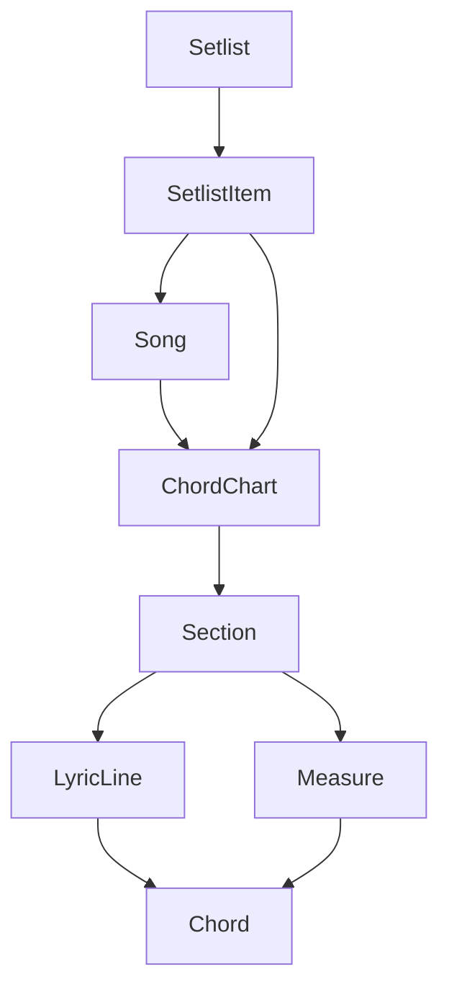

# Modelo de dominio

Este documento define o vocabulario inicial do Videira Music. A intencao e manter os termos consistentes entre produto, design e codigo.

## Objetivo

O Videira Music e um gerenciador de cifras para repertorios de igreja. O primeiro escopo cobre criacao, edicao, leitura, transposicao e organizacao de musicas cifradas.

## Entidades principais

### Song

Representa a musica como obra no catalogo.

Campos sugeridos:

- `id`: identificador unico.
- `title`: titulo da musica.
- `artist`: artista, ministerio, compositor ou fonte conhecida.
- `genre`: genero musical, inicialmente `gospel` ou `igreja`.
- `defaultKey`: tom principal usado no repertorio.
- `alternateKeys`: tons alternativos usados pela comunidade.
- `notes`: observacoes gerais, como uso em ofertas, ceia, abertura ou encerramento.

### ChordChart

Representa uma versao cifrada de uma musica.

Campos sugeridos:

- `id`: identificador unico.
- `songId`: referencia para `Song`.
- `title`: nome da versao quando for diferente do titulo da musica.
- `format`: `lyrics` ou `grid`.
- `key`: tom da cifra.
- `timeSignature`: formula de compasso, por exemplo `4/4`.
- `tempo`: andamento opcional em BPM.
- `capo`: casa do capotraste, quando aplicavel.
- `sections`: lista de secoes musicais.

### Section

Representa uma parte musical reutilizavel.

Tipos iniciais:

- `intro`
- `verse`
- `preChorus`
- `chorus`
- `bridge`
- `instrumental`
- `solo`
- `ending`

Campos sugeridos:

- `id`: identificador unico dentro da cifra.
- `type`: tipo da secao.
- `label`: nome exibido, como `Verso 1`, `Refrao` ou `Ponte`.
- `repeat`: quantidade de repeticoes sugeridas.
- `content`: conteudo da secao, variando conforme o formato da cifra.

### LyricLine

Linha de uma cifra com letra.

Campos sugeridos:

- `text`: letra da linha.
- `chords`: acordes posicionados sobre a linha.

Cada acorde precisa apontar para uma posicao na linha, preferencialmente por indice de caractere ou por token de palavra.

### Measure

Compasso de uma cifra sem letra.

Campos sugeridos:

- `index`: posicao do compasso dentro da secao.
- `beats`: quantidade de tempos do compasso, herdando `timeSignature` quando omitido.
- `chords`: acordes tocados no compasso.
- `repeatStart`: indica inicio de repeticao.
- `repeatEnd`: indica fim de repeticao.
- `ending`: casa de repeticao, como `1` ou `2`.

### Chord

Representa um acorde parseavel e transponivel.

Campos sugeridos:

- `raw`: texto original digitado, como `D/F#` ou `Bbmaj7`.
- `root`: nota principal, como `D` ou `Bb`.
- `quality`: qualidade ou sufixo, como `m`, `maj7`, `sus4`, `add9`.
- `bass`: baixo alternativo, como `F#` em `D/F#`.

### Setlist

Grupo de musicas para culto, ensaio ou apresentacao.

Campos sugeridos:

- `id`: identificador unico.
- `name`: nome do grupo.
- `date`: data opcional do culto ou evento.
- `items`: lista ordenada de musicas e cifras.
- `notes`: observacoes do repertorio.

## Relacionamentos

## Observacoes sobre dados existentes

O arquivo `data/musicas.json` ja funciona como catalogo inicial, mas seus campos ainda estao em texto livre. Em uma etapa futura, `meta` deve ser migrado para campos estruturados como `defaultKey`, `alternateKeys`, `artist` e `notes`.
