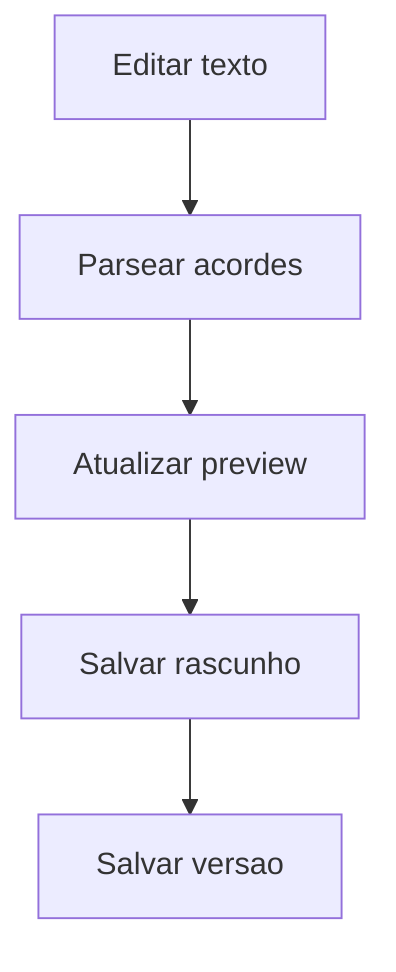
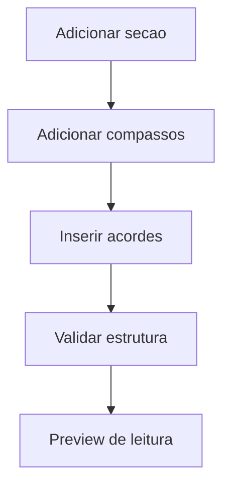
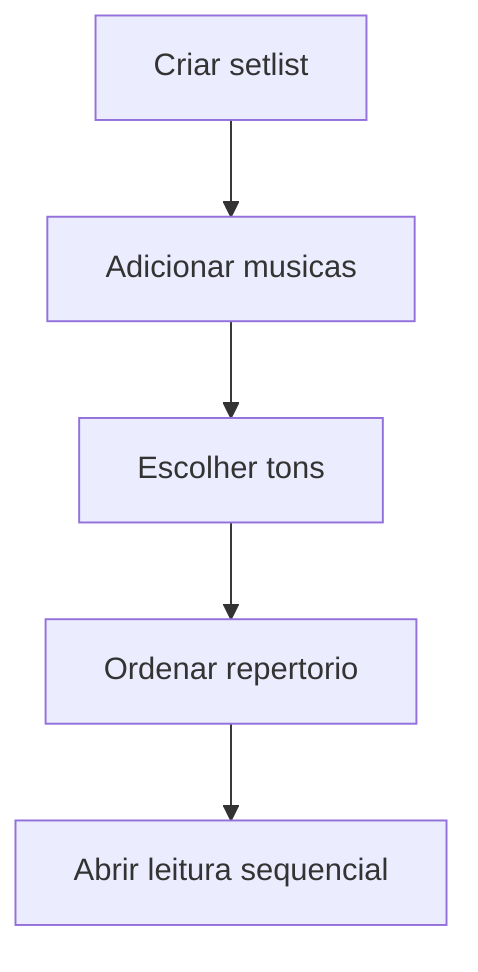

# Telas do MVP

Este documento descreve as primeiras telas do Videira Music e seus fluxos principais.

## 1. Biblioteca de musicas

Objetivo: encontrar rapidamente uma musica do repertorio.

Elementos:

- Campo de busca por titulo, artista ou tom.
- Filtros por genero, artista, tom e uso liturgico.
- Lista de musicas com titulo, artista e tom principal.
- Acoes: abrir, editar, criar cifra, adicionar a setlist.

Dados iniciais:

- Pode usar `data/musicas.json` como seed inicial do catalogo.
- O campo `meta` deve ser exibido temporariamente, mas depois migrado para campos estruturados.

## 2. Detalhe da musica

Objetivo: concentrar as cifras e metadados de uma musica.

Elementos:

- Titulo da musica.
- Artista ou ministerio.
- Tom original e tons alternativos.
- Lista de cifras disponiveis.
- Botao para criar cifra com letra.
- Botao para criar cifra sem letra.
- Historico ou observacoes do repertorio.

## 3. Editor de cifra com letra

Objetivo: criar ou editar cifra no estilo texto com acordes sobre a letra.

Elementos:

- Area de texto no formato ChordPro simplificado.
- Preview renderizado ao lado ou abaixo.
- Campo de tom.
- Campo de compasso.
- Botao de transpor.
- Validacao de acordes reconhecidos.
- Salvamento automatico em rascunho.

Fluxo:

## 4. Editor de cifra sem letra

Objetivo: montar a musica por secoes e compassos.

Elementos:

- Lista de secoes musicais.
- Grade de compassos.
- Campo para inserir acordes por compasso.
- Acoes para adicionar/remover/reordenar compassos.
- Marcadores de repeticao.
- Preview em formato de leitura.

Fluxo:

## 5. Modo leitura

Objetivo: usar a cifra durante ensaio, culto ou estudo.

Elementos:

- Visualizacao limpa e responsiva.
- Transposicao rapida.
- Controle de tamanho da fonte.
- Modo claro/escuro.
- Rolagem automatica opcional.
- Exibicao de secoes.
- Alternancia entre cifra com letra e cifra por compassos quando ambas existirem.

Prioridade:

- Legibilidade em celular e tablet.
- Poucas acoes visiveis durante a execucao.
- Nao depender de internet depois que a cifra estiver carregada.

## 6. Setlists

Objetivo: organizar musicas para um culto, ensaio ou evento.

Elementos:

- Nome da setlist.
- Data opcional.
- Lista ordenada de musicas.
- Tom escolhido por musica.
- Observacoes por item.
- Botao para abrir modo leitura sequencial.

Fluxo:

## Fora do MVP inicial

- Login completo.
- API publica.
- Verificacao de email, telefone, CPF ou CNPJ.
- Marketplace ou compartilhamento publico de cifras.
- Integracao direta com Sibelius, MuseScore ou CifraClub.
