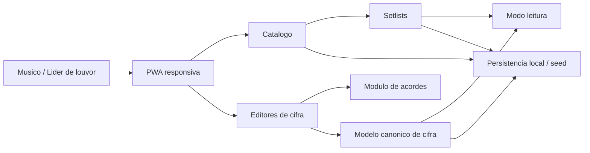

# TDD - Videira Music MVP

| Campo | Valor |
| --- | --- |
| Tech Lead | TBD |
| Product Manager | TBD |
| Time | TBD |
| Epic/Ticket | TBD |
| Status | Draft |
| Criado | 2026-10-09 |
| Ultima atualizacao | 2026-10-09 |

## Contexto

O Videira Music e uma PWA responsiva para gerenciamento de cifras em repertorios de igreja. O produto nasce para apoiar estudo, ensaio e culto em celular, tablet e notebook, com foco inicial em leitura clara, transposicao rapida, criacao de cifras e organizacao de setlists.

O repositorio ja possui um catalogo inicial de musicas, documentos de dominio, formatos de cifra, transposicao, telas do MVP, decisao de plataforma e plano tecnico de implementacao. Ainda nao existe uma aplicacao principal completa; a proxima etapa e transformar esses documentos em uma base funcional com Next.js, TypeScript, React, Tailwind CSS, testes unitarios e persistencia inicial local.

Este TDD consolida a direcao tecnica para o MVP e aplica principios de design modular: fronteiras bem definidas, comunicacao explicita por contratos, isolamento de estado, testabilidade por modulo e baixa dependencia entre areas internas.

## Definicao do Problema e Motivacao

### Problemas que estamos resolvendo

- **Repertorio espalhado e dificil de consultar**: cifras ficam em listas, arquivos ou fontes diferentes, o que atrasa busca e preparacao para ensaios.
  - Impacto: mais tempo manual para encontrar musicas, tons e observacoes.
- **Transposicao manual sujeita a erro**: mudar tom durante estudo ou ensaio exige conhecimento musical e revisao cuidadosa.
  - Impacto: risco de tocar acordes incorretos e baixa agilidade em ajustes para vocalistas.
- **Formatos de cifra inconsistentes**: letras cifradas e grades por compassos atendem momentos diferentes, mas normalmente nao compartilham um modelo comum.
  - Impacto: dificuldade para renderizar, transpor e evoluir a experiencia de leitura.

### Por que agora?

- O catalogo inicial ja existe e pode alimentar um prototipo util rapidamente.
- O risco principal do produto esta no modelo de cifra, na leitura e na transposicao, nao em API publica ou autenticacao.
- Uma PWA permite validar o fluxo em dispositivos reais sem custo inicial de aplicativo nativo.

### Impacto de nao resolver

- **Produto**: o projeto continua como colecao de documentos e scripts, sem validar a experiencia principal.
- **Tecnico**: o modelo de cifras pode se fragmentar se UI, parsing e persistencia nascerem acoplados.
- **Usuarios**: musicos seguem dependendo de ferramentas genericas que nao refletem o fluxo de igreja, setlist e leitura em culto.

## Escopo

### In Scope - MVP

- Criar a base da PWA responsiva.
- Modelar o dominio inicial: Song, ChordChart, Section, LyricLine, Measure, Chord, Setlist e SetlistItem.
- Carregar o catalogo seed existente como fonte inicial.
- Implementar parsing e transposicao de acordes com testes unitarios.
- Criar biblioteca de musicas com busca e tela de detalhe.
- Suportar cifra com letra em formato ChordPro simplificado.
- Suportar cifra sem letra por compassos.
- Renderizar preview e modo leitura para os dois formatos.
- Criar setlists locais com ordenacao, tom escolhido por musica e leitura sequencial.
- Usar persistencia local/prototipal, evoluindo depois para banco relacional.

### Fora do Escopo - MVP

- Login completo e gerenciamento de contas.
- API publica.
- Banco relacional em producao.
- Compartilhamento publico ou marketplace de cifras.
- Importacao automatica de sites de cifras sem licenca.
- Integracao com Sibelius, MuseScore, CifraClub ou MusicXML.
- Offline/PWA completo antes de leitura, transposicao e setlists estarem estaveis.
- Multitenancy, permissoes avancadas e auditoria completa.

### Consideracoes Futuras

- Autenticacao e sincronizacao entre dispositivos.
- PostgreSQL como persistencia principal.
- Cache offline de cifras abertas recentemente e setlists baixadas.
- Importacao/exportacao ChordPro.
- Exportacao de grades por compassos.
- Compartilhamento privado entre equipes de musica.

## Principios de Design Modular

### Fronteiras propostas

| Modulo | Responsabilidade | Estado autoritativo | Contrato publico interno |
| --- | --- | --- | --- |
| Catalogo | Listar, buscar e detalhar musicas | Song e metadados normalizados | Consultas de musicas e detalhes |
| Cifras | Criar, parsear e representar cifras | ChordChart, Section, LyricLine, Measure | Modelo canonico de cifra e operacoes de edicao |
| Acordes | Reconhecer, validar e transpor acordes | Regras musicais puras, sem estado persistente | Parser e transpositor |
| Setlists | Organizar repertorios para eventos | Setlist e SetlistItem | Operacoes de criacao, ordenacao e leitura sequencial |
| Leitura | Renderizar cifras para uso em ensaio/culto | Preferencias locais de leitura | View models de leitura e comandos de ajuste visual |
| Persistencia | Salvar e carregar dados do prototipo | Armazenamento local ou arquivos durante MVP | Repositorios/adaptadores por modulo |

### Regras de fronteira

- Modulos de UI devem depender de casos de uso ou adaptadores publicos, nao de detalhes de persistencia.
- O modulo de Acordes deve ser puro e testavel sem Next.js, React, storage ou dados reais.
- O modelo canonico de ChordChart deve ser a lingua comum entre editores, preview, leitura e transposicao.
- Catalogo nao deve conhecer detalhes de como a leitura renderiza uma cifra.
- Setlists devem referenciar musicas e cifras por identificadores e tom escolhido, evitando copiar dados autoritativos sem necessidade.
- Persistencia deve ser trocavel: primeiro local/prototipal, depois banco relacional, sem reescrever regras de dominio.

### Decisoes de acoplamento

- Permitido compartilhar tipos de contrato estaveis entre modulos.
- Evitar um modulo global de "dados" que registre todos os stores e exponha tudo para todos.
- Evitar regras musicais dentro de componentes visuais.
- Evitar que parsers dependam de layout, espacos manuais ou formato final de exibicao.

## Solucao Tecnica

### Visao Geral da Arquitetura

O MVP sera uma PWA com composicao fina nas rotas/telas e regras concentradas em modulos internos. A UI orquestra fluxos de usuario; os modulos de dominio executam parsing, transposicao, normalizacao e organizacao de dados; a persistencia inicial fornece adaptadores simples para seed local, rascunhos e preferencias.

**Componentes principais:**

- **Interface PWA**: biblioteca, detalhe de musica, editores, leitor e setlists.
- **Casos de uso internos**: buscar musicas, criar cifra, salvar rascunho, transpor, criar setlist e abrir leitura sequencial.
- **Modelo canonico de cifra**: estrutura comum para `lyrics` e `grid`.
- **Motor de acordes**: parser e transpositor puros.
- **Adaptadores de persistencia**: seed de catalogo, drafts locais e preferencias.

### Diagrama

Arquivo visual: `docs/technical-design/videira-music-mvp-flow.excalidraw`

### Fluxo de Dados

1. Usuario busca uma musica na biblioteca.
2. Catalogo consulta a fonte inicial e retorna musicas normalizadas para exibicao.
3. Usuario abre detalhe da musica e escolhe criar ou editar uma cifra.
4. Editor transforma texto de entrada em estrutura canonica.
5. Modulo de Acordes valida e transpoe simbolos sem conhecer UI ou persistencia.
6. Preview e modo leitura consomem o mesmo modelo canonico.
7. Setlist referencia musicas/cifras e registra tom escolhido e observacoes.
8. Persistencia local salva catalogo seed, rascunhos, setlists e preferencias de leitura enquanto o backend definitivo nao existe.

### Contratos de Dados

#### Song

| Campo | Descricao |
| --- | --- |
| id | Identificador unico da musica |
| title | Titulo exibido |
| artist | Artista, ministerio, compositor ou fonte |
| genre | Genero ou contexto musical |
| defaultKey | Tom principal usado no repertorio |
| alternateKeys | Tons alternativos |
| notes | Observacoes gerais |

#### ChordChart

| Campo | Descricao |
| --- | --- |
| id | Identificador unico da cifra |
| songId | Referencia para Song |
| format | `lyrics` ou `grid` |
| key | Tom da cifra |
| timeSignature | Formula de compasso |
| sections | Lista ordenada de secoes |
| source | Texto original opcional para auditoria/reprocessamento |

#### Setlist

| Campo | Descricao |
| --- | --- |
| id | Identificador unico da setlist |
| name | Nome do repertorio |
| date | Data opcional do culto, ensaio ou evento |
| items | Lista ordenada de musicas/cifras |
| notes | Observacoes gerais |

### APIs Internas / Casos de Uso

| Caso de uso | Entrada | Saida | Observacoes |
| --- | --- | --- | --- |
| Buscar musicas | Termo e filtros | Lista de Songs | Busca por titulo, artista, tom e meta temporario |
| Obter detalhe da musica | songId | Song com cifras disponiveis | Inicialmente cifras podem ser mockadas ou locais |
| Parsear cifra com letra | Texto ChordPro simplificado | ChordChart `lyrics` | Preserva source e separa letra/acordes |
| Parsear cifra por compassos | Texto com secoes e barras | ChordChart `grid` | Compassos viram estrutura validavel |
| Transpor cifra | ChordChart e semitons | ChordChart transposta | Mantem qualidade/extensoes |
| Criar setlist | Nome, data e itens | Setlist | Referencia musica/cifra por id |
| Abrir leitura sequencial | Setlist | Sequencia de leitura | Respeita tom escolhido por item |

### Estrategia de Persistencia

- **Fase MVP**: seed local para catalogo, armazenamento local para rascunhos, setlists e preferencias.
- **Evolucao**: repositorios/adaptadores por modulo para permitir migracao para banco relacional.
- **Regra de ownership**: cada modulo e dono conceitual do seu estado; a persistencia nao deve virar uma fachada que permite acesso direto a todos os dados internos.

## Riscos

| Risco | Impacto | Probabilidade | Mitigacao |
| --- | --- | --- | --- |
| Parser de acordes crescer em complexidade | Alto | Medio | Limitar casos do MVP, cobrir com testes e preservar texto original |
| Modelo canonico nao atender bem lyrics e grid | Alto | Medio | Validar com exemplos reais antes de persistir em formato definitivo |
| UI de edicao por compassos ficar complexa cedo demais | Medio | Alto | Comecar com entrada textual + preview antes de editor visual rico |
| Acoplamento entre UI, parsing e storage | Alto | Medio | Manter regras em modulos puros e usar contratos internos claros |
| Dados do catalogo inicial pouco estruturados | Medio | Alto | Normalizacao incremental de `meta` para campos explicitos |
| Conteudo de terceiros sem licenca | Alto | Medio | Usar seed proprio/licenciado e evitar importacao automatica no MVP |
| Offline virar prioridade antes do core estar validado | Medio | Medio | Adiar PWA offline completo ate leitura/transposicao/setlists estabilizarem |

## Estrategia de Testes

| Tipo | Escopo | Criterio |
| --- | --- | --- |
| Unitarios | Parser e transpositor de acordes | Casos obrigatorios de acordes simples, baixo, extensoes e falhas controladas |
| Unitarios | Parsers de cifras | Converter entradas `lyrics` e `grid` para modelo canonico |
| Integracao leve | Casos de uso internos | Buscar musica, criar cifra, transpor, criar setlist |
| UI / E2E futuro | Fluxos principais | Biblioteca -> detalhe -> editor -> preview -> leitura -> setlist |

### Cenarios criticos

- Transpor `D/F#` mantendo baixo alternativo.
- Preservar extensoes como `maj7`, `sus4`, `add9` e `m7(b5)`.
- Renderizar cifra com letra sem depender de espacos manuais.
- Validar compassos com um ou mais acordes.
- Criar setlist e abrir leitura sequencial com tons escolhidos.

## Monitoramento e Observabilidade

Como o MVP inicial roda sem backend publico, a observabilidade deve ser proporcional ao escopo:

| Sinal | Objetivo | Quando aplicar |
| --- | --- | --- |
| Erros de parsing | Entender entradas nao suportadas | Desde o editor inicial |
| Falhas de persistencia local | Evitar perda de rascunhos/setlists | Desde setlists e rascunhos |
| Eventos de fluxo | Medir uso de busca, transposicao e leitura | Quando houver analytics consentido |
| Web vitals | Garantir leitura responsiva em mobile/tablet | Antes de publicar para usuarios reais |

Regras:

- Nao registrar letras, cifras completas ou dados sensiveis sem consentimento explicito.
- Logs devem apontar o modulo responsavel pelo erro: Catalogo, Cifras, Acordes, Setlists, Leitura ou Persistencia.
- Erros de parsing devem preservar contexto tecnico suficiente sem vazar conteudo integral.

## Consideracoes de Seguranca

- O MVP nao deve coletar credenciais, dados financeiros ou documentos pessoais.
- Dados locais devem ser tratados como conteudo do usuario; evitar envio automatico para servicos externos.
- Nao armazenar segredos no frontend.
- Se analytics for adicionado, deve haver criterio claro para anonimizar eventos e evitar conteudo musical bruto nos payloads.
- Importacao de conteudo externo deve respeitar licencas e direitos autorais.

## Plano de Rollback

### Durante o MVP local

- Mudancas de modelo devem manter capacidade de reprocessar `source` quando existir.
- Alteracoes de parsers devem ser protegidas por testes de regressao.
- Se uma versao quebrar leitura ou transposicao, desabilitar temporariamente o fluxo afetado e preservar edicao/leitura basica.

### Quando houver deploy publico

| Gatilho | Acao |
| --- | --- |
| Erro recorrente ao abrir cifras | Reverter versao da PWA e investigar parser/renderizador |
| Perda de rascunhos ou setlists locais | Bloquear nova escrita, orientar exportacao/backup e corrigir persistencia |
| Degradacao forte em mobile/tablet | Reverter UI de leitura ou desabilitar recurso experimental |
| Regressao de transposicao | Desabilitar transposicao para formatos afetados e corrigir com testes |

## Plano de Implementacao

| Fase | Entrega | Descricao | Status | Estimativa |
| --- | --- | --- | --- | --- |
| 1 - Base | PWA inicial | App responsiva, layout base, lint e testes | TODO | 2-3 dias |
| 2 - Dominio | Tipos e contratos | Modelo de Song, ChordChart, Section, Chord e Setlist | TODO | 1-2 dias |
| 3 - Acordes | Parser e transpositor | Regras puras com cobertura unitaria | TODO | 2-3 dias |
| 4 - Catalogo | Biblioteca e detalhe | Seed inicial, busca e detalhe de musica | TODO | 2-3 dias |
| 5 - Cifras lyrics | Editor + preview | Entrada ChordPro simplificada e renderizacao | TODO | 3-5 dias |
| 6 - Cifras grid | Editor + preview | Entrada por secoes/compassos e renderizacao | TODO | 3-5 dias |
| 7 - Setlists | Repertorios locais | Criar, ordenar, escolher tom e abrir leitura sequencial | TODO | 3-4 dias |
| 8 - Polimento | Leitura e responsividade | Ajustes mobile/tablet, acessibilidade e criterio de pronto | TODO | 2-4 dias |

## Criterios de Pronto do MVP

- Biblioteca lista musicas do catalogo inicial.
- Usuario abre detalhe de musica.
- Usuario cria/visualiza cifra com letra de exemplo.
- Usuario cria/visualiza cifra por compassos de exemplo.
- Transposicao funciona nos dois formatos.
- Setlist local permite ordenar musicas e abrir leitura sequencial.
- Modulo de Acordes tem testes unitarios para os casos obrigatorios.
- Persistencia inicial salva rascunhos/setlists sem acoplar regras de dominio.

## Questoes em Aberto

| Questao | Contexto | Dono | Status |
| --- | --- | --- | --- |
| Quem sera Tech Lead formal? | Metadata do TDD e revisao tecnica | TBD | Aberta |
| Qual e o criterio minimo de publicacao da PWA? | Deploy publico vs uso local/testflight informal | TBD | Aberta |
| Quais campos de `meta` devem virar estrutura primeiro? | Normalizacao do catalogo seed | TBD | Aberta |
| Rascunhos serao salvos automaticamente desde V1? | UX do editor e risco de perda | TBD | Aberta |
| Setlists precisam funcionar offline no MVP ou apenas depois? | Priorizacao PWA | TBD | Aberta |

## Glossario

| Termo | Descricao |
| --- | --- |
| Cifra com letra | Formato em que acordes aparecem associados a trechos da letra |
| Cifra por compassos | Formato sem letra, organizado em secoes e barras de compasso |
| Modelo canonico | Estrutura interna comum consumida por editores, renderizadores e transposicao |
| Transposicao | Alteracao de tom preservando qualidade, extensoes e baixos dos acordes |
| Setlist | Repertorio ordenado para culto, ensaio ou evento |
| PWA | Aplicacao web instalavel, com evolucao futura para recursos offline |

## Validacao do TDD

- Secoes obrigatorias presentes: Contexto, Problema, Escopo, Solucao Tecnica, Riscos e Plano de Implementacao.
- Secoes criticas incluidas de forma proporcional ao MVP: Testes, Observabilidade, Seguranca e Rollback.
- Lacunas reais foram marcadas como `TBD` para revisao posterior.
- O desenho modular evita API publica e banco definitivo antes de validar leitura, parsing, transposicao e setlists.
